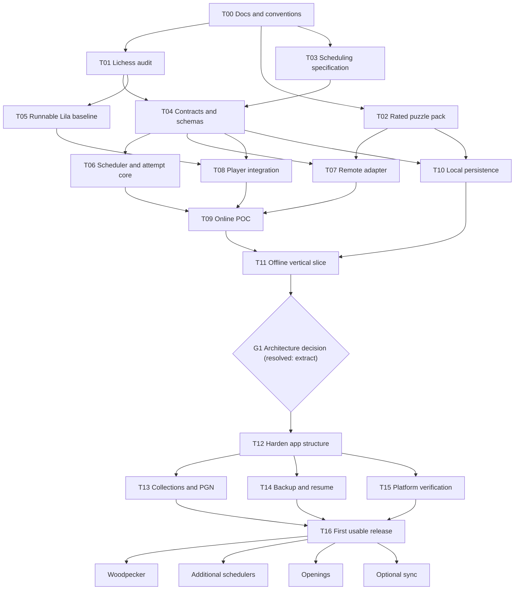

# ChessReps working plan

Status: product build-out in progress (spike promoted by ADR-005); PB0–PB6 PWA done (offline startup verified headlessly); T11 real-device pass remaining; personal use initially.

## Goal and delivery sequence

A phone/desktop chess trainer with curated exercise collections and interchangeable training methods. Start with an online puzzle spaced-repetition POC reusing Lichess code. Prove independent offline operation early. Add Woodpecker, openings, other schedulers, and optional synchronization later.

## Confirmed decisions

| ID | Decision |
|---|---|
| D01 | Personal use initially; public accounts/sharing are not initial requirements. |
| D02 | Phone and desktop interaction are required. |
| D03 | Independent offline operation is the target; online POC is acceptable. Sync can wait. |
| D04 | Puzzles before openings; spaced repetition before Woodpecker. |
| D05 | Correctness first, solving time second. Time initially makes a small interval adjustment. |
| D06 | First wrong solution move fails the scored attempt, but the player stays on the puzzle and can finish solving. Correction never overwrites failure. |
| D07 | User-configurable failure policy: retry/relearning or moving backward in scheduling progress. |
| D08 | Borrow Anki's established learning/relearning queue concepts rather than inventing a new queue model. |
| D09 | Interchangeable grading, schedulers, and training/session-selection methods. Preserve raw attempt history. |
| D10 | Source rated starter puzzles from existing databases, initially Lichess, including around rating 1000. Support PGN import as well. |
| D11 | Prefer substantial Lichess code reuse. Investigate a full fork and adapting/extracting its puzzle player fairly. |
| D12 | Investigate common interfaces with online and bundled local implementations. Prove the local boundary before broad feature expansion. |
| D13 | Do not fork Lila. Reuse Lichess libraries (chessground, chessops) and content, and own the training service with a local adapter now and a remote adapter later. Resolves Q01 (see ADR-005). |

## Architectural direction (decided 2026-10-09)

**Decided: no Lila fork — extract and reuse (ADR-005).** Build a focused app that reuses
Lichess libraries (`chessground`, `chessops`) and CC0 content, and owns the training-service
boundary with a local adapter now and a remote adapter later. The requirement for
online **and** offline operation is the deciding factor: a fork is server-authoritative and
makes offline a second app, while the extracted path is offline-first and gains online via a
drop-in remote adapter. The table below records why the rejected candidates lost.

| Candidate | Benefit | Why rejected |
|---|---|---|
| Full Lila fork | Preserve puzzle UI, services, analysis | Server stack (Mongo/Redis/sbt); no clean offline path; "online" is just self-hosted Lichess; merge maintenance |
| Extract/adapt puzzle player | Substantial reuse in focused offline app | Accepted as the direction, realized as library reuse rather than copying Lila's server-coupled controller |
| Focused player using Lichess libraries | Simpler local-first boundaries | **Chosen approach** |
| Lichess Flutter app fork | Native foundation | Separate stack; same server-authority problem |
| Service-worker HTTP interception | Preserve existing request sites | Lifecycle complexity; does not solve server bootstrap |

Proposed, not confirmed: installable web app, browser database, interval ladder, short relearning step, about 100 puzzles per rating pack, client-side TypeScript scheduling, explicit Next button, illegal drops not counted as failed solution moves. Research must distinguish defaults from user decisions.

```text
Lichess-derived puzzle player
              |
      Training service interface
              |
      +-------+--------+
      |                |
 Online adapter    Local adapter
      |                |
 Application API   Browser storage + local training logic
```

Retain Lichess puzzle contracts where useful; add explicit collection, attempt, session, and schedule concepts. Submission and next selection may preserve an existing response shape while being separate internally.

## Domain requirements

- Puzzle: actual solver starting position, solution, optional setup move, source ID, rating snapshot, themes and original content.
- Collection: selected puzzle references and settings.
- Attempt: identity, correctness, moves, timing, assistance, failure and eventual completion.
- Schedule: algorithm ID/version/settings, learning state, due time, algorithm-specific state.
- Session: selected collection/program, queue and current attempt; resumable.
- Training program: method-specific progress; later includes fixed-set Woodpecker cycles.

### Attempt lifecycle

1. Start scored attempt; play automatic opponent replies.
2. First wrong solution move persists failure and enters correction mode without advancing.
3. Finishing after correction remains a failed scored attempt.
4. A later scheduled retry is a new attempt from the starting position.
5. Reloads/repeated submissions cannot double-apply scheduling updates.

### Scheduling and timing

Use New, Learning, Review, and Relearning states, with configurable step-back alternative. Separate attempt interpretation, bounded timing adjustment, interval calculation, and queue selection. Keep active solving time separate from correction time; define loading, animation, backgrounding, pause and abandonment semantics. Raw timing survives algorithm changes.

### Content

Primary source: https://database.lichess.org/#puzzles (CC0). Prepare small reproducible packs rather than requiring phones to download the full database. Candidate rating bands: 700–899, 900–1099, 1100–1299, 1300–1499, 1500–1699. Around 1000 is the POC pack.

Preserve IDs and dated ratings; validate every position/solution; respect Lichess's first setup move convention; consider duplicate positions and rating confidence. Include manifests recording source, selection method, version, count and checksums. PGN import starts with puzzle positions and explicit solution lines. Explanatory variations are not automatically accepted solutions.

## Open issues

| ID | Issue | Resolution gate |
|---|---|---|
| Q01 | Full fork or extracted frontend? | **Resolved 2026-10-09 → extract/reuse, no fork (ADR-005)** |
| Q02 | Authoritative scheduling location online? | T04 |
| Q03 | Preserve which Lichess response contracts? | T01/T04 |
| Q04 | Interval ladder and bounded timing formula? | T03/T06 |
| Q05 | Default failure preset/relearning delay? | T03/settings review |
| Q06 | Pause, background, abandonment behavior? | T03/T04 |
| Q07 | Hints and reveals grading? | T03/T08 |
| Q08 | Alternative winning moves and solution branches? | T01/T08 |
| Q09 | Progress shared across collections or independent? | T04 before persistence |
| Q10 | Pack quality thresholds and sample size? | T02 |
| Q11 | Application license and reused asset provenance? | T01/T12 |
| Q12 | Backup and scheduler migration policy? | T04/T14 |

## Dependency graph



## Task board and acceptance criteria

Checkbox means acceptance verified, not merely code written. Status: Not started → In progress → In review → Done; Blocked records an explicit cause.

- [x] **T00 — Save working docs and conventions.** Master plan, graph, decision register, issue register, agent handoffs and ownership saved.
- [x] **T01 — Lichess reuse audit.** Status: Done (research only). [Dependency audit](research/lichess-puzzle-dependencies.md) pins upstream revision and covers bootstrap, network, player/views, services, licenses and online/local seams. Runtime baseline remains T05.
- [x] **T02 — Reproducible rated puzzle pack.** Status: Done for around-1000 POC pack. Tool, retained snapshot, 100 puzzles, manifest and validation report delivered. Coordinator reran 8 passing tests and successful pack verification. See [content report](research/puzzle-content-sources.md) and `../tools/puzzles/README.md`. Other rating bands remain future content work.
- [x] **T03 — Anki-inspired scheduling specification.** Status: Done (design only). [Specification](research/scheduling-behavior.md) covers explicit transitions, presets, bounded timing, queue/interruptions and 21 acceptance scenarios. Numeric defaults remain proposals; no scheduler implemented.
- [x] **T04 — Contracts and schemas.** Status: Done for architecture-neutral contracts. `packages/contracts/` defines the UI↔training-service boundary, attempt identity, idempotent outcome commits, immutable scored failure, correction separation, and versioned content/progress schemas. Reference in-memory test double + 7 passing contract tests; fixtures use real pack entries. Coordinator reran tests (`node --test --experimental-strip-types`) and typecheck (`tsc --noEmit`), both clean. Q02/Q09 recorded as **Proposed** ADRs ([ADR-001](decisions/ADR-001-training-service-boundary.md), [ADR-002](decisions/ADR-002-progress-scope-and-authority.md)), not accepted. Q03 remains open. See [contracts design](research/contracts-design.md). Real scheduler is T06.
- [x] **T05 — Runnable Lila baseline.** Status: Done (measured reference). The unchanged Lila at pinned SHA `f5b261e3d8ece6f511484e398cb8d81e37735bea` was compiled (Scala 3.8.4, sbt 2.0.10, 169 s), run on :9663 (native mongod 7.0.14 + redis 7.2.5, since Docker was inaccessible), seeded with one puzzle + source game, and the real puzzle page driven headlessly: wrong move → failure feedback → continued solving → `win=true` → continue → next round. Evidence in `tools/lichess-baseline/evidence/`. All servers stopped; no system-wide installs. See [baseline report](research/lichess-baseline.md).
- [x] **T06 — Scheduler/attempt core.** Status: Done. `packages/scheduler/` implements the T03 model as a pure, clock-injectable projection on `ScheduleStateDetails`: New/Learning/Review/Relearning, an 8-rung ladder, `retry-reset`/`retry-retain`/`step-back` failure presets, bounded isolated timing (±10%, capped), idempotent commits and stale-revision rejection. All **21 T03 acceptance scenarios** pass as named tests; typecheck clean (coordinator reran). Defaults recorded as **Proposed** [ADR-003](decisions/ADR-003-scheduler-defaults.md). See [scheduler implementation](research/scheduler-implementation.md). Numeric defaults remain unvalidated proposals.
- [ ] **T07 — Remote adapter (online mode).** Depends T02/T04 (Lila itself no longer a dependency per ADR-005). Implement the T04 `TrainingService` against a thin API of our own, for eventual online/sync. Acceptance: session start, recording, selection and resume meet contracts; offline→online reconciliation uses idempotency keys and revision guards. Does not depend on Lila web-internal endpoints as durable storage.
- [x] **T08 — Player integration.** Status: Done (extracted-library path). `apps/web/` is a runnable Vite app using Lichess' own `chessground` + `chessops` (not the Lichess controller): starts from `solverFen` (+ optional setup animation), enforces failure-and-continue (wrong move commits one immutable scored failure without advancing), supports correction and explicit Next, pawn promotion with a role picker, active/correction timing with hidden-time exclusion, responsive/touch layout and a tiny i18n layer, and reports attempts through the T04 `TrainingService` now backed by the real T06 scheduler. 26 tests pass; build succeeds. See [player spike](research/player-spike.md). Preserving the Lichess *controller* itself was deliberately not done (extraction path).
- [ ] **T09 — Online POC integration.** Depends T06/T07/T08. Acceptance: actual rated collection trained, corrected, scheduled and resumed through UI.
- [x] **T10 — Local persistence adapter.** Status: Done. `apps/player-spike/src/storage/` provides a storage seam (IndexedDB + in-memory fallback) with versioned envelopes; content, per-program scheduler state, raw attempt history and sessions persist separately. A reload restores content, order, schedules and an open attempt (replays logged moves; a scored failure resumes as correction). `?reset=1` clears state. Coordinator reran 26 tests including IndexedDB (fake-indexeddb) + reload round-trip; build succeeds. See [local persistence](research/local-persistence.md) and [ADR-004](decisions/ADR-004-local-storage-and-selection.md) (Proposed).
- [ ] **T11 — Offline vertical slice.** Status: **Partial (offline startup now verified headlessly)**. The local player runs entirely from bundled pack content with no server and persists across reload (schedules, history, open attempt), and the app shell is a static Vite bundle. A hand-written service worker now keeps the shell offline: the `puppeteer` smoke installs it, confirms the page is controlled and the cache holds the shell + hashed bundle, then **reloads with the network disabled and mounts the board**. Still needs a real browser/phone pass (touch, promotion, backgrounding, multi-puzzle, failure, resume) to record real-device results.
- [x] **G1 — Architecture decision.** Resolved early (2026-10-09) by user decision: **extract/reuse, no Lila fork**. Rationale, rejected alternatives and measured evidence in [ADR-005](decisions/ADR-005-architecture-extraction-not-fork.md); Q01 closed. T11 remains an offline *verification* task, not a decision gate. T12 still depends on this decision and is now unblocked architecturally.
- [x] **T12 — Harden app structure.** Status: Done. PB0–PB6 completed; reproducible build (root workspaces, Vite build), boundaries stable, attribution updated via manifest/icons/third-party notice; PWA/SM addressed in PB6.
- [x] **T13 — Collection UI/PGN import.** Status: Done. Collections screen stub exists and PGN import with preview/confirm + ambiguity reporting is implemented in Puzzles view; Lichess CSV + JSONL + creator/editor/removal also implemented.
- [x] **T14 — Backup/restore/recovery.** Status: Done. Full export/import, pre-import snapshots, restore, reloadAfterDataChange, and data-port migration policy implemented in PB5.
- [ ] **T15 — Phone/desktop/offline verification.** Depends T12. Status: Partial. Headless offline startup (service worker + cache + network-disabled reload) verified by smoke; real device pass (touch, promotion, layout, backgrounding, multi-puzzle, failure, resume, PWA install) still pending.
- [ ] **T16 — First usable release.** Depends T13/T14/T15. Evidence for initial requirements, documented limitations, no blocking issues.

## Parallel execution and ownership

- Wave 1: T01 audit, T02 content, T03 scheduling design.
- Wave 2: T04 contracts and T05 baseline.
- Wave 3 after contract stabilization: T06 core, T07 online, T08 player, T10 local.
- Integration gates: T09, T11 (G1 resolved 2026-10-09, ADR-005); do not skip offline proof.
- Completion wave: T13, T14, T15 after T12, with shared UI files coordinated.

No concurrent edits to shared contracts or the master plan. Integration owner manages both. Agents may edit only assigned paths, report needed cross-boundary changes, and provide evidence with handoffs. No commits/pushes unless requested. Do not delete others' work. Research may recommend decisions but must not silently turn proposals into user-approved requirements.

## Future work

- **F01 Woodpecker:** fixed-set snapshots, cycle coverage, shorter cycle targets, accuracy/active-time comparisons, correction-attempt semantics, transition to maintenance.
- **F02 Schedulers:** FSRS evaluation, selection per program, versioned state, explicit history migration, timing-policy comparisons.
- **F03 Openings:** repertoire PGNs, side selection, per-decision/full-line review, transpositions, accepted moves, contextual prompts.
- **F04 Sync:** stable record/device IDs, conflict handling, attempt deduplication, content versions and schedule recomputation authority.
- **F05 Content:** more bands/themes, study imports, engine-assisted alternatives, difficulty suggestions and hybrid training experiments.

## Wave 1 review and next handoff — 2026-10-09

Three independent agents completed T01/T02/T03. Coordinator reviewed all research documents and reran the content tests and CLI verification. No application/server baseline has been run. Research completion does not settle Q01 or approve all proposed defaults.

Key findings for T04/T05:

1. Training API replacement alone is insufficient: add a host/content bootstrap boundary. The web player reconstructs original-game SAN from the standard starting position; database packs supply midgame FEN plus a setup move. Root-ply navigation and engine initial-position assumptions need adaptation.
2. Existing first-failure/continued-solving behavior is reusable, but Lichess's in-memory result flag and per-puzzle session strip are not durable attempt identity or retry-safe scheduling persistence.
3. Around-1000 pack: 100 puzzles, ratings 900–1098, mean 1002.1, runtime payload 66,702 bytes. All 493 eligible source candidates were legally replayed. Pack hash: `5f26a52606c60c11c92b4d3a61e25eee66b1845bc7a09d9310042e3671da1e7f`.
4. Pack sampling is a deterministic bounded-prefix POC sample, not a globally random/theme-balanced collection. The retained source enables exact offline rebuilding; a fresh upstream download may differ.
5. Scheduling specification distinguishes Anki concepts from the proposed ladder and timing adjustment. T04 should explicitly decide progress scope and scheduling authority before parallel implementation. Retry-reset versus retry-retain remains a default-policy choice, not a new user instruction.

Next eligible parallel tasks: T04 contracts/schema design and T05 baseline setup. T04 must record provisional implementation decisions transparently; T05 must inspect available tooling before installing or starting infrastructure. Neither task has started yet.

## Wave 2 review and next handoff — 2026-10-09

Two agents ran T04 (contracts) and T05 (baseline). Coordinator verified T04 by running the 7
contract tests and `tsc --noEmit` (both clean) and wrote/persisted the T05 baseline report
from the agent's verified findings. The pinned Lila clone exists at the correct SHA; no server
was started.

Key findings:

1. **Contracts are usable and architecture-neutral.** The same `TrainingService` interface
   targets both an HTTP adapter and a bundled local adapter. Outcomes are idempotent via
   idempotency keys, scored failure is immutable, and correction is a separate step. Progress
   scope is provisionally per training program (ADR-002, Proposed).
2. **The full unchanged-Lila baseline is heavy.** It needs sbt/coursier plus MongoDB and Redis;
   none are installed. Docker can host the services, but the Scala build is the real cost. This
   is achievable but is not a quick win, and it does **not** unblock the offline goal by itself.
3. **The offline path does not require the full server.** T01/T05 both point to a FEN-rooted
   content seam (`solverFen` + `setupUci` + `solutionUci`) plus host-service injection. This can
   be proven with Chessground + chessops over the T02 pack, independent of the backend build.

Recommended next wave (parallel, after this review):

- **T06 — scheduler/attempt core:** implement the deterministic scheduler against the T04
  contracts (T03 spec), with transition tests. Independent of the Lila build.
- **T08-lite — FEN-rooted local player spike:** minimal Chessground + chessops page that loads
  the T02 pack, enforces failure-and-continue, and reports attempts through the contracts. This
  is the fastest route to a *visible, testable* vertical slice and informs the Q01 fork-vs-
  extraction decision.
- **T05 (optional, human/system):** install sbt/coursier + Docker Mongo/Redis and complete the
  unchanged baseline if the explicit comparison is still wanted.

Open decisions still requiring confirmation before persistence work: **Q02** (authority
online), **Q03** (which Lichess response contracts to preserve), **Q09** (progress scope),
**Q12** (backup/migration). ADR-001 and ADR-002 remain Proposed.

## Wave 3 review and next handoff — 2026-10-09

Two agents ran T06 (scheduler core) and T08-lite (FEN-rooted player spike). Coordinator
independently reran every suite and the build, and fixed defects found during review.

Verified by coordinator (not just agent claims):

- `packages/contracts`: 7 tests pass; `tsc --noEmit` clean.
- `packages/scheduler`: **21 tests pass**; `tsc --noEmit` clean.
- `apps/web`: 6 tests pass; `vite build` succeeds (~42 KB gzip 14 KB).
- Fixes applied on review:
  1. Spike never committed the scored failure through the contract and later called
     `commitSuccess` after a failure. Now the first wrong move commits an immutable failure
     and completion calls `finishCorrection` (or `commitSuccess` only if never failed).
  2. **T04 reference double keying bug:** schedule states were seeded by `puzzle.id` but
     looked up by `programId:puzzleId`, so `commitOutcome` schedule updates were silently a
     no-op (the original test only asserted `committed`). States are now created lazily under
     the documented per-program key, and the test asserts the `new→learning` advance.
  3. Spike test runner added to `package.json`; Vite `__dirname` warning removed.

Key conclusions:

1. **The offline seam is proven.** A Lichess-library player can run entirely from pack FEN +
   solution UCI, with no server and no original-game PGN. This directly supports the local
   path for Q01 without waiting on the blocked Lila baseline.
2. **The failure/correction contract is now genuinely exercised end-to-end** (grading →
   adapter → immutable outcome → correction), which was the highest-risk behavior.
3. **The scheduler is a real, replaceable policy** with all 21 T03 scenarios green; its
   numbers are still provisional.

Legitimate next options (pick one focus):

- **T10 — local persistence adapter:** persist content/history/schedules/session over the
  contracts (e.g. IndexedDB) so the spike survives reload. Highest-value offline step.
- **T09-lite — wire T06 into the spike:** replace the reference stub with the real scheduler
  and add selection/due logic, so a full session is scheduled by `@chessreps/scheduler`.
- **T05 — finish the unchanged Lila baseline:** install sbt/coursier + Docker Mongo/Redis and
  complete the comparison if the explicit Q01 fork evidence is still wanted.

Still open/unconfirmed: Q01 (architecture — no decision yet), Q02/Q03/Q09/Q12, ADR-001/002/003
all Proposed. The T02 pack is a deterministic bounded-prefix sample, not theme-balanced.

## Wave 4 review and next handoff — 2026-10-09

Two agents ran T05 (finish the baseline) and a combined T09-lite + T10 + phone/touch spike
maturation. Coordinator independently reran all suites, the build, and the baseline evidence
check, and fixed defects found on review.

Verified by coordinator (not just agent claims):

- `apps/web`: **26 tests pass**; `vite build` succeeds (91 KB / 29 KB gzip); no lila/mongo/redis
  ports left listening and no leftover heavy processes.
- T05 evidence is genuine: `summary.json` contains real Lichess page feedback
  (`"✗ That's not the move! Try something else."`), a `win=false` then `win=true` POST to
  `/training/complete/mix/abcde`, and a real next-puzzle payload; screenshots exist.
- Fixes applied on review:
  1. `LocalStore.unwrap` version checks passed the record's own version, so incompatible schemas
     were never rejected. Now uses explicit expected-version constants per collection.
  2. Duplicate `finishCorrection` appended a second correction event; duplicates are now idempotent
     and do not re-append evidence.

Now true:

1. **A complete local training loop exists:** real scheduler (T06) + persistence (T10) + player (T08),
   offline-capable, failure-immutable, correction-aware, with due-based selection and reload resume.
2. **Q01 now has both measured sides:** unchanged-Lila baseline (heavy: sbt+mongo+redis, ~1.3 GB
   build tree, but interaction verified) vs. the extracted-library spike (no server, static bundle,
   FEN-rooted). The evidence favors the extracted path for a personal offline trainer; the decision
   itself is still open and should be recorded as an ADR at G1.
3. T05's baseline showed the completion endpoint is web-internal with no durable attempt state, and
   `lila-ws` is optional for the puzzle route (only Redis looked required) — confirms T07 should not
   treat Lila HTTP as ChessReps' durable scheduling API.

Open/unconfirmed: Q01, Q02, Q03, Q12; ADR-001/002/003/004 all Proposed. T11 needs a real
browser/phone pass. The T02 pack remains a deterministic bounded-prefix sample.

Recommended next:

- **T11 manual verification pass** on desktop + phone (disable network, reload, multi-puzzle,
  failure, resume) to convert T11 from Partial to Done and produce real-device evidence.
- **T09-lite → T09:** wire the same contracts to an online adapter (T07) or add feedback/UX polish.
- **G1 decision:** once T11 is verified, record the fork-vs-extraction architecture decision with the
  Wave 4 evidence.

## Architecture decision — 2026-10-09

**Decision (user): no Lila fork — continue from the extraction path.** Recorded as
[ADR-005](decisions/ADR-005-architecture-extraction-not-fork.md) (Accepted). This resolves
**Q01** and **G1** ahead of the T11 manual pass.

Rationale:

1. **Online + offline is a hard requirement**, and it is the deciding factor. A Lila fork is
   server-authoritative (Mongo/Redis/websocket) and would make offline a second app inside the
   fork, while its "online" mode is essentially self-hosted Lichess. The extracted path is
   offline-first and gains online later via a drop-in remote adapter over the T04 contract.
2. **Both paths are now measured.** T05 baseline (heavy, no durable attempt state) vs. the
   spike (no server, static bundle, 26 tests green, scheduler + IndexedDB persistence).
3. **Reuse is kept where it is safe.** Lichess's `chessground`/`chessops` libraries and CC0
   content are reused; Lichess's server-coupled controller and web-internal endpoints are not.

Consequences reflected on the board:

- **G1 → Done.** **T12** is architecturally unblocked (still depends on finishing T11's
  verification for release readiness).
- **T07 re-scoped** as a *remote adapter* to our own thin API over the T04 contract; Lila is no
  longer a dependency and its HTTP is not used as durable scheduling storage.
- **T11 remains** an offline *verification* task (real browser/phone pass), not a decision gate.
- Licensing: reused libraries are GPL; fine for personal use, revisit before public distribution (Q11).

Still open/unconfirmed: Q02/Q03/Q12 (Q04/Q05/Q06/Q07 now covered by ADR-003 defaults, Proposed);
ADR-001/002/003/004 remain Proposed implementation defaults, not architecture blockers.

## Product build-out (post-decision) — starting 2026-10-09

The architecture decision (ADR-005) promotes the extracted spike from a proof to the
actual product. This sequence turns `apps/web` (formerly `apps/player-spike`) into a real
app with content and settings management. Tasks T12 (harden structure) and T13
(collections/PGN) are realized through these phases.

Constraints that must hold across every phase:

- **Data continuity:** stored program/collection IDs, the IndexedDB database name
  (`chessreps-player-spike`, intentionally retained) and storage schema versions are not
  changed casually; the app keeps working with existing progress.
- **No silent data loss:** export/import + a migration policy (Q12) land before the first
  new persisted schema (settings).
- **Verification each phase:** tests pass + production build succeeds; user-visible phases
  also get a device/browser check.

| Phase | Scope | Tasks | Status |
|---|---|---|---|
| PB0 | Rename `apps/player-spike` → `apps/web`; neutralize "spike" strings; preserve IDs/DB name | T12 | **Done 2026-10-09** |
| PB1 | Monorepo hygiene: root workspaces, package exports, package imports, drop `fs.allow`, root scripts, CSS extraction | T12 | **Done 2026-10-09** |
| PB2 | App shell: hash router, screens (Train/Puzzles/Collections/Settings/History); fix solution spoiler; wire Skip; due counts; split `main.ts` | T12 | **Done 2026-10-09** |
| PB3 | Puzzles screen: pack library + JSONL upload; puzzle creator (FEN+solution, chessops-validated); Lichess CSV import; PGN import with ambiguity preview | T13 | **Done** 2026-10-09 (library, JSONL, creator/editor/remove, Lichess CSV, PGN preview) |
| PB4 | Settings screen (curated: failure preset, new-per-day, timing on/off, relearning delay) + versioned persisted settings store | T13/T12 | **Done** 2026-10-09 (curated prefs, persisted `settings` collection, new-per-day enforced) |
| PB5 | Data safety: full JSON export/import + migration policy + recovery | T14/Q12 | **Done** 2026-10-09 (lossless JSON export/import, preview+confirm, pre-import snapshots, restore) |
| PB6 | T11 device verification pass; PWA (manifest + service worker) | T11/T15 | **PWA Done 2026-10-09** (manifest, icons, service worker; offline boot verified headlessly). T11 real-device pass remaining |

| PB7 | Stockfish analysis + attempt review (review-mode only, full-attempt navigation, lazy-loaded full single-threaded build) | T15/UX | Not started (documented) |
Content-import scope agreed with user (2026-10-09): JSONL file upload first, a single-puzzle
creator (FEN + solution), then Lichess puzzle-CSV import (reusing `tools/puzzles` validation
rules) and PGN import. A pack is content only; scheduling stays per program over the same
`ProgressKey`. CSV/JSONL/PGN are ingestion formats, not a new content model.

### Build-out handoff — 2026-10-09

**PB2 done.** The spike is now an app shell with a hash router and five screens
(Train/Puzzles/Collections/Settings/History); `main.ts` is split into `app.ts`, `app-context.ts`,
`router.ts`, `screens.ts`, `train-view.ts`; a `training-adapter.ts` layer now owns session/resume
and Skip semantics; the solution spoiler no longer leaks on the initial render.

Verified by coordinator (not just code claims):

- Root `npm test` = **58** (7 contracts + 21 scheduler + 30 web, incl. new `skip.node.test.ts`);
  `tsc --noEmit` clean in `packages/*`; `npm run build` = 101 KB JS / 32 KB gzip.
- **New automated browser smoke** (`apps/web/scripts/smoke.mjs`, `npm run smoke` via
  `puppeteer-core` + system Chromium against `vite preview`): boots with no console errors; all
  five nav screens mount; queue reports `100 puzzles · 100 new · 100 due now · 0 learned`; a
  puzzle is selected and the board mounts; the solution is hidden until Reveal; Reveal abandons
  without scoring ("no score recorded for this attempt"); Skip moves to a different puzzle
  (`ID: 01q5Z -> ID: 02SDA`) with a fresh attempt; navigating away and back remounts the board.
- A missing favicon (only boot-time 404) is fixed with a self-contained SVG data URI.

Semantics locked for future phases: **Skip** = session-scoped exclusion
(`SelectNextRequest.excludedKeys`) + abandon without scoring; **Reveal** = abandon without
scoring and no exclusion; both release the reservation. The queue summary counts
new/learned/due per program. Content/IDs/DB name/schema versions were untouched (data
continuity held).

Next: **PB3** (Puzzles screen) — pack library + JSONL upload + single-puzzle creator first,
then Lichess puzzle-CSV and PGN import; keep `tools/puzzles` validation rules shared.

### Build-out handoff — PB3a–c (2026-10-09)

The Puzzles screen is live and content is now user-manageable. Scope done so far: the pack
library view, JSONL import, and the single-puzzle creator/editor/remover. Lichess CSV and PGN
imports remain for this phase.

- **Shared validator** `apps/web/src/validation/puzzle-validation.ts` ports the `tools/puzzles`
  rules to chessops: legal FEN, legal solution plies from the solver position, setup-move
  bridging for `sourceFen`→`solverFen`, `mate` theme must end in checkmate, and `solverColor`
  must match the side to move. It also parses JSONL and normalizes creator input.
- **Service/content API** (`scheduler-service.ts`): `listPuzzles`, `upsertPuzzles` (merge:
  replace same id, append new), `removePuzzle` (drops content + derived schedule, **keeps raw
  attempt history per D09**), additive `ContentSetMeta` refresh. `LocalStore` gained
  `deletePuzzle`/`deleteSchedule`. No storage schema version changed.
- **Puzzles screen** (`apps/web/src/puzzles-view.ts`): pack panel, JSONL file import, creator /
  edit form (`FEN`, optional source FEN + setup move, solution, rating, themes, source id),
  per-puzzle schedule status, and remove-with-confirm.

Verified by coordinator: root `npm test` = **69** (7 contracts + 21 scheduler + 41 web, of which
12 are new validation/content tests); typecheck clean; production build succeeds (116 KB / 36 KB
gzip). The browser smoke now also exercises the Puzzles screen end-to-end: create a puzzle (id
auto-assigned), see it in the library, **reload and confirm it persists**, import a JSONL file,
and remove a puzzle — all with no page errors.

Deliberate semantics: editing a puzzle with the same id keeps its schedule/history (the id is the
progress slot); removing a puzzle deletes derived state but never the attempt log. Import is
additive (never wipes the library); boot-time seeding still only runs when the library is empty.

Next in PB3: Lichess puzzle-**CSV** import and **PGN** import (with an ambiguity/mistake-branch
preview), reusing the same validator.

### Build-out handoff — PB3d–e (2026-10-09)

PB3 is complete. Both remaining importers reuse the shared chessops validator and stay additive
(never wipe the library).

- **Lichess CSV** (`parseLichessCsv` in `puzzle-validation.ts`): RFC-4180-ish `parseCsvRows`
  (quoted fields), requires columns `PuzzleId,FEN,Moves,Rating,…`; the first `Moves` ply is the
  opponent setup move applied to `FEN` to derive `solverFen`; the rest must be a legal alternating
  solution. Imported with `source:'lichess'`, preserving extra columns in `originalFields`.
- **PGN** (`previewPgn`): each game becomes a candidate — its start position (honoring `SetUp`/
  `FEN` headers) is the solver position and its **mainline** is the solution. Variations are
  **counted and reported but never imported as solutions** (T13: no silent mistake branches). The
  screen shows a preview list (game #, plies, solver color, variation count, or a per-game error
  for illegal SAN / unsupported variant) with an explicit "Import N" confirm before committing,
  so nothing is imported blindly.

Verified by coordinator: root `npm test` = **77** (7 contracts + 21 scheduler + 49 web; web gained
the CSV/PGN validation tests); typecheck clean; production build succeeds (142 KB / 43 KB gzip).
The browser smoke now also exercises CSV import and the PGN preview→confirm→import flow with no
page errors.

### Build-out handoff — PB5 (2026-10-09)

Data safety landed **before** any new persisted schema, per the T14/Q12 rule. Persisted data now
has a documented, reversible escape hatch.

- **Lossless export** (`LocalStore.exportData`): every collection (`content`, `schedules`,
  `attempts`, `sessions`, `meta`) is snapshotted as its raw on-disk envelopes, wrapped in a
  self-describing `chessreps-export` document (`formatVersion`, `exportedAt`, `backendKind`).
- **Safe import** (`parseExport` in `storage/data-port.ts`): validates the format marker, rejects
  unknown/newer versions, and runs sequential migrations to the current version. The Settings
  screen shows a **preview summary** (timestamp + per-collection counts) and requires an explicit
  confirm before replacing anything.
- **Recovery** (`LocalStore.saveBackup`/`loadBackup`, `COLLECTION_BACKUPS`): every import first
  snapshots current data under `pre-import-<ts>` (excluded from exports so it cannot recurse), and
  the Settings screen lists snapshots with one-click **Restore**. Restoring itself backs up the
  data being replaced. After any import/restore the training adapter is reset
  (`reloadAfterDataChange`) so no stale attempt or progress key survives.
- **Migration policy (Q12)** is documented in `storage/data-port.ts`: add a `Migration` per format
  bump; never edit a shipped migration; per-record `schemaVersion` mismatches are already treated
  as absent by the store, so a restore never misinterprets data.

While verifying PB5 the smoke uncovered and fixed a **pre-existing seeding bug**: the bundled
`pack.jsonl` predates the contract and omitted `contentSchemaVersion`, so its stored envelopes had
`schemaVersion: undefined` and were silently dropped on the next load — the bundled 100-puzzle
library vanished after any reload. `pack-loader.ts` now normalizes pack rows (stamps
`contentSchemaVersion: '1.0.0'`, maps `original`→`originalFields`), and `LocalStore.savePuzzles`
falls back to the expected version for any unstamped record. Regression test:
`tests/pack-loader.node.test.ts`.

Verified by coordinator: root `npm test` = **82** (7 contracts + 21 scheduler + 54 web); typecheck
clean; production build succeeds (150 KB / 45 KB gzip). The smoke now also checks that the bundled
library **survives reload**, then exercises the full Settings data-safety flow: export a file,
preview it, import it (creating a recovery snapshot), and restore the snapshot — the library
returns to exactly its pre-import size, with no page errors.

### Build-out handoff — PB4 (2026-10-09)

The Settings screen now edits a curated set of scheduler preferences, with a small versioned store.

- **Curated prefs** (`settings-preferences.ts`): failure preset (`retry-reset` / `retry-retain` /
  `step-back`) plus its amount, new-puzzles-per-day, timing on/off, and relearning delay. Only this
  subset is persisted; the rest of `SchedulerSettings` is always re-derived from `DEFAULT_SETTINGS`
  via `resolveSettings`, so improving a default later is picked up automatically and the stored
  schema stays tiny. `parseCurated` clamps every value and rejects unknown presets on read.
- **Versioned store**: new `settings` collection (`EXPECTED_SETTINGS_SCHEMA_VERSION`), included in
  full exports/imports. `LocalTrainingService.init` loads it; `applyCuratedSettings` persists and
  rebuilds the `Scheduler`. A change takes effect on the **next** attempt — in-flight attempts keep
  the settings snapshot they started with (unchanged `settingsHash` semantics).
- **New-per-day is now real**: `selectNext` counts puzzles introduced today (local day, per program)
  and stops offering new puzzles once `newIntroductionLimitPerDay` is reached. Previously the field
  existed in settings but was never enforced.

Verified by coordinator: root `npm test` = **86** (7 contracts + 21 scheduler + 58 web); typecheck
clean; production build succeeds (156 KB / 46 KB gzip). The smoke saves a preference and confirms
it **persists across reload**, on top of the PB5 export/import/restore flow, with no page errors.

## Sources

- https://github.com/lichess-org/lila
- https://github.com/lichess-org/lila/wiki/Lichess-Development-Onboarding
- https://github.com/lichess-org/lila/blob/master/ui/puzzle/src/ctrl.ts
- https://github.com/lichess-org/lila/blob/master/ui/puzzle/src/xhr.ts
- https://database.lichess.org/#puzzles
- https://docs.ankiweb.net/studying.html
- https://www.chessable.com/blog/the-woodpecker-method/
