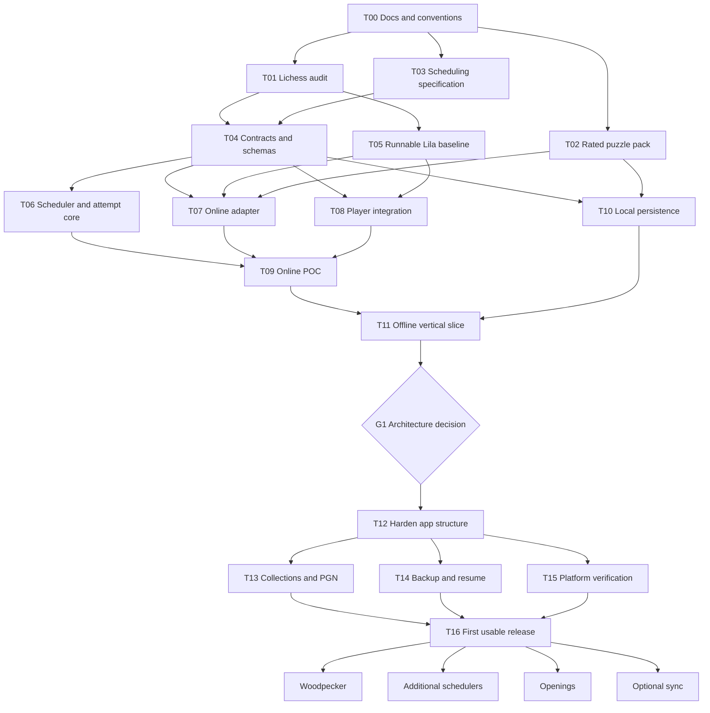

# ChessReps working plan

Status: research and proof-of-concept preparation. Initial audience: personal use.

## Goal and delivery sequence

A phone/desktop chess trainer with curated exercise collections and interchangeable training methods. Start with an online puzzle spaced-repetition POC reusing Lichess code. Prove independent offline operation early. Add Woodpecker, openings, other schedulers, and optional synchronization later.

## Confirmed decisions

| ID | Decision |
|---|---|
| D01 | Personal use initially; public accounts/sharing are not initial requirements. |
| D02 | Phone and desktop interaction are required. |
| D03 | Independent offline operation is the target; online POC is acceptable. Sync can wait. |
| D04 | Puzzles before openings; spaced repetition before Woodpecker. |
| D05 | Correctness first, solving time second. Time initially makes a small interval adjustment. |
| D06 | First wrong solution move fails the scored attempt, but the player stays on the puzzle and can finish solving. Correction never overwrites failure. |
| D07 | User-configurable failure policy: retry/relearning or moving backward in scheduling progress. |
| D08 | Borrow Anki's established learning/relearning queue concepts rather than inventing a new queue model. |
| D09 | Interchangeable grading, schedulers, and training/session-selection methods. Preserve raw attempt history. |
| D10 | Source rated starter puzzles from existing databases, initially Lichess, including around rating 1000. Support PGN import as well. |
| D11 | Prefer substantial Lichess code reuse. Investigate a full fork and adapting/extracting its puzzle player fairly. |
| D12 | Investigate common interfaces with online and bundled local implementations. Prove the local boundary before broad feature expansion. |

## Architectural direction versus unresolved choices

Agreed direction: inspect a Lila-based online POC, introduce a training-service boundary, then test a minimal local adapter. No final fork/extraction choice has been made.

| Candidate | Benefit | Cost / uncertainty |
|---|---|---|
| Full Lila fork | Preserve existing puzzle UI, services, preferences, and analysis | Operate server stack; introduce offline path; upstream merge maintenance |
| Extract/adapt puzzle player | Substantial reuse in focused offline app | Untangle application services, views, styles, bootstrap |
| Focused player using Lichess libraries | Simpler local-first boundaries | More interaction and validation to implement |
| Lichess Flutter app fork | Native foundation | Separate stack; desktop/web suitability needs investigation |
| Service-worker HTTP interception | Preserve existing request sites | Lifecycle complexity; does not solve server bootstrap alone |

Proposed, not confirmed: installable web app, browser database, interval ladder, short relearning step, about 100 puzzles per rating pack, client-side TypeScript scheduling, explicit Next button, illegal drops not counted as failed solution moves. Research must distinguish defaults from user decisions.

```text
Lichess-derived puzzle player
              |
      Training service interface
              |
      +-------+--------+
      |                |
 Online adapter    Local adapter
      |                |
 Application API   Browser storage + local training logic
```

Retain Lichess puzzle contracts where useful; add explicit collection, attempt, session, and schedule concepts. Submission and next selection may preserve an existing response shape while being separate internally.

## Domain requirements

- Puzzle: actual solver starting position, solution, optional setup move, source ID, rating snapshot, themes and original content.
- Collection: selected puzzle references and settings.
- Attempt: identity, correctness, moves, timing, assistance, failure and eventual completion.
- Schedule: algorithm ID/version/settings, learning state, due time, algorithm-specific state.
- Session: selected collection/program, queue and current attempt; resumable.
- Training program: method-specific progress; later includes fixed-set Woodpecker cycles.

### Attempt lifecycle

1. Start scored attempt; play automatic opponent replies.
2. First wrong solution move persists failure and enters correction mode without advancing.
3. Finishing after correction remains a failed scored attempt.
4. A later scheduled retry is a new attempt from the starting position.
5. Reloads/repeated submissions cannot double-apply scheduling updates.

### Scheduling and timing

Use New, Learning, Review, and Relearning states, with configurable step-back alternative. Separate attempt interpretation, bounded timing adjustment, interval calculation, and queue selection. Keep active solving time separate from correction time; define loading, animation, backgrounding, pause and abandonment semantics. Raw timing survives algorithm changes.

### Content

Primary source: https://database.lichess.org/#puzzles (CC0). Prepare small reproducible packs rather than requiring phones to download the full database. Candidate rating bands: 700–899, 900–1099, 1100–1299, 1300–1499, 1500–1699. Around 1000 is the POC pack.

Preserve IDs and dated ratings; validate every position/solution; respect Lichess's first setup move convention; consider duplicate positions and rating confidence. Include manifests recording source, selection method, version, count and checksums. PGN import starts with puzzle positions and explicit solution lines. Explanatory variations are not automatically accepted solutions.

## Open issues

| ID | Issue | Resolution gate |
|---|---|---|
| Q01 | Full fork or extracted frontend? | G1 after online/local spikes |
| Q02 | Authoritative scheduling location online? | T04 |
| Q03 | Preserve which Lichess response contracts? | T01/T04 |
| Q04 | Interval ladder and bounded timing formula? | T03/T06 |
| Q05 | Default failure preset/relearning delay? | T03/settings review |
| Q06 | Pause, background, abandonment behavior? | T03/T04 |
| Q07 | Hints and reveals grading? | T03/T08 |
| Q08 | Alternative winning moves and solution branches? | T01/T08 |
| Q09 | Progress shared across collections or independent? | T04 before persistence |
| Q10 | Pack quality thresholds and sample size? | T02 |
| Q11 | Application license and reused asset provenance? | T01/T12 |
| Q12 | Backup and scheduler migration policy? | T04/T14 |

## Dependency graph



## Task board and acceptance criteria

Checkbox means acceptance verified, not merely code written. Status: Not started → In progress → In review → Done; Blocked records an explicit cause.

- [x] **T00 — Save working docs and conventions.** Master plan, graph, decision register, issue register, agent handoffs and ownership saved.
- [x] **T01 — Lichess reuse audit.** Status: Done (research only). [Dependency audit](research/lichess-puzzle-dependencies.md) pins upstream revision and covers bootstrap, network, player/views, services, licenses and online/local seams. Runtime baseline remains T05.
- [x] **T02 — Reproducible rated puzzle pack.** Status: Done for around-1000 POC pack. Tool, retained snapshot, 100 puzzles, manifest and validation report delivered. Coordinator reran 8 passing tests and successful pack verification. See [content report](research/puzzle-content-sources.md) and `../tools/puzzles/README.md`. Other rating bands remain future content work.
- [x] **T03 — Anki-inspired scheduling specification.** Status: Done (design only). [Specification](research/scheduling-behavior.md) covers explicit transitions, presets, bounded timing, queue/interruptions and 21 acceptance scenarios. Numeric defaults remain proposals; no scheduler implemented.
- [x] **T04 — Contracts and schemas.** Status: Done for architecture-neutral contracts. `packages/contracts/` defines the UI↔training-service boundary, attempt identity, idempotent outcome commits, immutable scored failure, correction separation, and versioned content/progress schemas. Reference in-memory test double + 7 passing contract tests; fixtures use real pack entries. Coordinator reran tests (`node --test --experimental-strip-types`) and typecheck (`tsc --noEmit`), both clean. Q02/Q09 recorded as **Proposed** ADRs ([ADR-001](decisions/ADR-001-training-service-boundary.md), [ADR-002](decisions/ADR-002-progress-scope-and-authority.md)), not accepted. Q03 remains open. See [contracts design](research/contracts-design.md). Real scheduler is T06.
- [ ] **T05 — Runnable Lila baseline.** Status: **Partial / Blocked** (setup feasibility only). Pinned-revision clone succeeded (`f5b261e3d8ece6f511484e398cb8d81e37735bea`, 183 MB) and tooling was probed, but the app could not be started: **sbt/coursier, MongoDB and Redis are not installed**. Docker is available for services; exact next commands recorded. No puzzle route or seeded content verified. See [baseline report](research/lichess-baseline.md).
- [x] **T06 — Scheduler/attempt core.** Status: Done. `packages/scheduler/` implements the T03 model as a pure, clock-injectable projection on `ScheduleStateDetails`: New/Learning/Review/Relearning, an 8-rung ladder, `retry-reset`/`retry-retain`/`step-back` failure presets, bounded isolated timing (±10%, capped), idempotent commits and stale-revision rejection. All **21 T03 acceptance scenarios** pass as named tests; typecheck clean (coordinator reran). Defaults recorded as **Proposed** [ADR-003](decisions/ADR-003-scheduler-defaults.md). See [scheduler implementation](research/scheduler-implementation.md). Numeric defaults remain unvalidated proposals.
- [ ] **T07 — Online adapter.** Depends T02/T04/T05. API/session/attempt persistence. Acceptance: session start, recording, selection and resume meet contracts.
- [ ] **T08 — Player integration.** Status: **Partial (FEN-rooted spike)**. `apps/player-spike/` is a runnable Vite app using Lichess' own `chessground` + `chessops`: loads the T02 pack, starts from `solverFen` (+ optional setup animation), enforces failure-and-continue (wrong move commits an immutable scored failure without advancing), supports correction and an explicit Next, and reports attempts through the T04 `TrainingService`. 6 tests pass; production build succeeds (coordinator reran). See [player spike](research/player-spike.md). NOT yet: injection into the real Lichess player/controllers, timing/eventing completeness, phone layout.
- [ ] **T09 — Online POC integration.** Depends T06/T07/T08. Acceptance: actual rated collection trained, corrected, scheduled and resumed through UI.
- [ ] **T10 — Local persistence adapter.** Depends T02/T04. Local content/history/schedules/session. Acceptance: contract tests and reload persistence.
- [ ] **T11 — Offline vertical slice.** Depends T09/T10. Cache app shell and run locally. Acceptance: disable network, reload, solve multiple puzzles, record failure, resume saved progress; record hidden dependencies and phone results.
- [ ] **G1 — Architecture decision.** Depends T11. Compare observed costs and behavior; record chosen structure, rejected alternatives, rationale. Not predetermined.
- [ ] **T12 — Harden app structure.** Depends G1. Reproducible build, boundaries, attribution and deployment.
- [ ] **T13 — Collection UI/PGN import.** Depends T12. Create collections, preview/import supported PGNs, report ambiguity, preserve original content. Never silently accept explanatory mistake branches.
- [ ] **T14 — Backup/restore/recovery.** Depends T12. Content/progress round-trip; resume interruptions without losing failure or duplicating results; versioned format.
- [ ] **T15 — Phone/desktop/offline verification.** Depends T12. Agreed device matrix: touch, promotion, layout, backgrounding, reload, offline startup and persistence.
- [ ] **T16 — First usable release.** Depends T13/T14/T15. Evidence for initial requirements, documented limitations, no blocking issues.

## Parallel execution and ownership

- Wave 1: T01 audit, T02 content, T03 scheduling design.
- Wave 2: T04 contracts and T05 baseline.
- Wave 3 after contract stabilization: T06 core, T07 online, T08 player, T10 local.
- Integration gates: T09, T11, G1; do not skip offline proof.
- Completion wave: T13, T14, T15 after T12, with shared UI files coordinated.

No concurrent edits to shared contracts or the master plan. Integration owner manages both. Agents may edit only assigned paths, report needed cross-boundary changes, and provide evidence with handoffs. No commits/pushes unless requested. Do not delete others' work. Research may recommend decisions but must not silently turn proposals into user-approved requirements.

## Future work

- **F01 Woodpecker:** fixed-set snapshots, cycle coverage, shorter cycle targets, accuracy/active-time comparisons, correction-attempt semantics, transition to maintenance.
- **F02 Schedulers:** FSRS evaluation, selection per program, versioned state, explicit history migration, timing-policy comparisons.
- **F03 Openings:** repertoire PGNs, side selection, per-decision/full-line review, transpositions, accepted moves, contextual prompts.
- **F04 Sync:** stable record/device IDs, conflict handling, attempt deduplication, content versions and schedule recomputation authority.
- **F05 Content:** more bands/themes, study imports, engine-assisted alternatives, difficulty suggestions and hybrid training experiments.

## Wave 1 review and next handoff — 2026-10-09

Three independent agents completed T01/T02/T03. Coordinator reviewed all research documents and reran the content tests and CLI verification. No application/server baseline has been run. Research completion does not settle Q01 or approve all proposed defaults.

Key findings for T04/T05:

1. Training API replacement alone is insufficient: add a host/content bootstrap boundary. The web player reconstructs original-game SAN from the standard starting position; database packs supply midgame FEN plus a setup move. Root-ply navigation and engine initial-position assumptions need adaptation.
2. Existing first-failure/continued-solving behavior is reusable, but Lichess's in-memory result flag and per-puzzle session strip are not durable attempt identity or retry-safe scheduling persistence.
3. Around-1000 pack: 100 puzzles, ratings 900–1098, mean 1002.1, runtime payload 66,702 bytes. All 493 eligible source candidates were legally replayed. Pack hash: `5f26a52606c60c11c92b4d3a61e25eee66b1845bc7a09d9310042e3671da1e7f`.
4. Pack sampling is a deterministic bounded-prefix POC sample, not a globally random/theme-balanced collection. The retained source enables exact offline rebuilding; a fresh upstream download may differ.
5. Scheduling specification distinguishes Anki concepts from the proposed ladder and timing adjustment. T04 should explicitly decide progress scope and scheduling authority before parallel implementation. Retry-reset versus retry-retain remains a default-policy choice, not a new user instruction.

Next eligible parallel tasks: T04 contracts/schema design and T05 baseline setup. T04 must record provisional implementation decisions transparently; T05 must inspect available tooling before installing or starting infrastructure. Neither task has started yet.

## Wave 2 review and next handoff — 2026-10-09

Two agents ran T04 (contracts) and T05 (baseline). Coordinator verified T04 by running the 7
contract tests and `tsc --noEmit` (both clean) and wrote/persisted the T05 baseline report
from the agent's verified findings. The pinned Lila clone exists at the correct SHA; no server
was started.

Key findings:

1. **Contracts are usable and architecture-neutral.** The same `TrainingService` interface
   targets both an HTTP adapter and a bundled local adapter. Outcomes are idempotent via
   idempotency keys, scored failure is immutable, and correction is a separate step. Progress
   scope is provisionally per training program (ADR-002, Proposed).
2. **The full unchanged-Lila baseline is heavy.** It needs sbt/coursier plus MongoDB and Redis;
   none are installed. Docker can host the services, but the Scala build is the real cost. This
   is achievable but is not a quick win, and it does **not** unblock the offline goal by itself.
3. **The offline path does not require the full server.** T01/T05 both point to a FEN-rooted
   content seam (`solverFen` + `setupUci` + `solutionUci`) plus host-service injection. This can
   be proven with Chessground + chessops over the T02 pack, independent of the backend build.

Recommended next wave (parallel, after this review):

- **T06 — scheduler/attempt core:** implement the deterministic scheduler against the T04
  contracts (T03 spec), with transition tests. Independent of the Lila build.
- **T08-lite — FEN-rooted local player spike:** minimal Chessground + chessops page that loads
  the T02 pack, enforces failure-and-continue, and reports attempts through the contracts. This
  is the fastest route to a *visible, testable* vertical slice and informs the Q01 fork-vs-
  extraction decision.
- **T05 (optional, human/system):** install sbt/coursier + Docker Mongo/Redis and complete the
  unchanged baseline if the explicit comparison is still wanted.

Open decisions still requiring confirmation before persistence work: **Q02** (authority
online), **Q03** (which Lichess response contracts to preserve), **Q09** (progress scope),
**Q12** (backup/migration). ADR-001 and ADR-002 remain Proposed.

## Wave 3 review and next handoff — 2026-10-09

Two agents ran T06 (scheduler core) and T08-lite (FEN-rooted player spike). Coordinator
independently reran every suite and the build, and fixed defects found during review.

Verified by coordinator (not just agent claims):

- `packages/contracts`: 7 tests pass; `tsc --noEmit` clean.
- `packages/scheduler`: **21 tests pass**; `tsc --noEmit` clean.
- `apps/player-spike`: 6 tests pass; `vite build` succeeds (~42 KB gzip 14 KB).
- Fixes applied on review:
  1. Spike never committed the scored failure through the contract and later called
     `commitSuccess` after a failure. Now the first wrong move commits an immutable failure
     and completion calls `finishCorrection` (or `commitSuccess` only if never failed).
  2. **T04 reference double keying bug:** schedule states were seeded by `puzzle.id` but
     looked up by `programId:puzzleId`, so `commitOutcome` schedule updates were silently a
     no-op (the original test only asserted `committed`). States are now created lazily under
     the documented per-program key, and the test asserts the `new→learning` advance.
  3. Spike test runner added to `package.json`; Vite `__dirname` warning removed.

Key conclusions:

1. **The offline seam is proven.** A Lichess-library player can run entirely from pack FEN +
   solution UCI, with no server and no original-game PGN. This directly supports the local
   path for Q01 without waiting on the blocked Lila baseline.
2. **The failure/correction contract is now genuinely exercised end-to-end** (grading →
   adapter → immutable outcome → correction), which was the highest-risk behavior.
3. **The scheduler is a real, replaceable policy** with all 21 T03 scenarios green; its
   numbers are still provisional.

Legitimate next options (pick one focus):

- **T10 — local persistence adapter:** persist content/history/schedules/session over the
  contracts (e.g. IndexedDB) so the spike survives reload. Highest-value offline step.
- **T09-lite — wire T06 into the spike:** replace the reference stub with the real scheduler
  and add selection/due logic, so a full session is scheduled by `@chessreps/scheduler`.
- **T05 — finish the unchanged Lila baseline:** install sbt/coursier + Docker Mongo/Redis and
  complete the comparison if the explicit Q01 fork evidence is still wanted.

Still open/unconfirmed: Q01 (architecture — no decision yet), Q02/Q03/Q09/Q12, ADR-001/002/003
all Proposed. The T02 pack is a deterministic bounded-prefix sample, not theme-balanced.

## Sources

- https://github.com/lichess-org/lila
- https://github.com/lichess-org/lila/wiki/Lichess-Development-Onboarding
- https://github.com/lichess-org/lila/blob/master/ui/puzzle/src/ctrl.ts
- https://github.com/lichess-org/lila/blob/master/ui/puzzle/src/xhr.ts
- https://database.lichess.org/#puzzles
- https://docs.ankiweb.net/studying.html
- https://www.chessable.com/blog/the-woodpecker-method/
