## Wave B/C execution graph (autonomous loop)

Loop rules: a task is **ready** when all deps are Done and none of its
`Owns` paths are touched by another running task. Each round the coordinator
spawns all ready tasks in parallel, then verifies combined
(`npm test`, `npm run typecheck`, `npm run build`), commits if green, updates
this file, and starts the next round. Stop at user-gated items.
`PROJECT_PLAN.md` wording stays coordinator-owned; agents never edit it.
No pushes; commits only.

```mermaid
flowchart TD
  B1["B1 UX-004 fairness (done)"] --> T16["T16 release (user sign-off)"]
  B2["B2 HIST-API + rows (done)"] --> T16
  B3["B3 DOC-001 sweep (done)"] --> T16
  UX5["UX-005 remove practice-ahead"] --> T16
  B5["B5 AN-001a review (done)"] --> T16
  B6["B6 update toast (done)"] --> T16
  B4["B4 Collections (done)"] --> T16
  UI["UI-001 Snabbdom foundation (done)"] --> T16
  STY["STY-001 unstyled elements"] --> T16
  I18N["I18N-001 toast keys"] --> REL2["REL-002 periodic update check"]
  REL2 --> T16
  SET["SET-001 new-per-day 100"] --> T16
  LANE["train-view lane: MOB-001 done → BRD-001 → BRD-003 → BRD-004 → STS-001 → REV-002 → TRN-001 → BRD-002 (one at a time)"] --> T16
  THM["THM-001 board theme picker"] --> T16
  PZL["PZL-001 Lichess-inspired puzzle layout"] --> T16
  PZL --> PZL2["PZL-002 show setup/previous move"]
  F01["F01 Woodpecker cycles + failed review"]
  F01 --> WP1["WP-001 Woodpecker from a collection"]
  PZL2 --> PZL3["PZL-003 Lichess-style move list"]
  PZL3 --> PZL4["PZL-004 animate setup move"]
  B4 --> COL1["COL-001 collapse member lists"]
  F01 --> SPD1["SPD-001 spaced hub"]
  WP1 --> T16
  PZL3 --> T16
  PZL4 --> T16
  COL1 --> T16
  SPD1 --> T16
  F05a["F05a bundled rating-band collections"] --> T16
  STAT["STAT-001 training time & activity statistics (needs decisions)"] --> T16
  REV["REV-001 resumed-review (needs user call)"] --> T16
  HW["T11/T15 hardware (needs device)"] --> T16
```

| ID | Task | Deps | Owns (exclusive) | Status |
|---|---|---|---|---|
| B1 | UX-004 queue tiebreaker: document + lock simultaneous-due order | UX-001 (done) | `packages/scheduler/src/selection.ts`, `packages/scheduler/tests/**` | Done (`a328313`) |
| B2 | HIST-API: read-only `listAttempts` + History per-attempt rows | History view (done) | `apps/web/src/scheduler-service.ts` (append-only method), `apps/web/src/history-view.ts`, `apps/web/src/i18n.ts` (`history.*` only), `apps/web/tests/history*` | Done (`a328313`) |
| B3 | DOC-001 sweep: `screens.ts` header, ADR 001–004 accept/defer note, T13 status note | — | `apps/web/src/screens.ts` (header comment only), `docs/research/adr-sweep.md` (new) | Done (`a328313`; ADR accept/defer still pending user) |
| B5 | AN-001a attempt review (no engine): step through own attempt moves | UX-001 (done) | `apps/web/src/train-view.ts`, `apps/web/src/puzzle-game.ts`, `apps/web/src/training-adapter.ts`, `apps/web/src/i18n.ts` (`review.*` only), `apps/web/tests/review*` | Done (`ce3f011`) |
| B6 | REL-001 remainder: in-app "update available" reload toast | REL-001 policy (done) | `apps/web/src/app.ts` (SW registration only), `apps/web/src/i18n.ts` (`app.update.*` only) | Done (`ce3f011`; strings hardcoded → I18N-001) |
| B4 | T13-followup real Collections screen — **USER DECISION 2026-10-15: per-collection separate progress; static sets with multi-membership; active-collection picker on Train. Overrides ADR-002 proposal (per-program). Schedule rekey to collection scope + schema bump/migration approved in principle; raw history preserved.** | B3, ~~user scope~~ decided | `packages/contracts` (ProgressKey scope), `apps/web/src/scheduler-service.ts`, `apps/web/src/collections-view.ts` (new), `apps/web/src/screens.ts` (collections entry), `apps/web/src/app.ts`, `apps/web/src/train-view.ts` (picker), `apps/web/src/i18n.ts` (`collections.*`), storage/migration | Done (`ec3fa0e`) |
| UX-005 | Infinite collection flow through ordinary Next; fallback to earliest future-due puzzle after normal eligible work | UX-001 (clarified; remove separate practice button only) | `apps/web/src/scheduler-service.ts` selectNext fallback, `apps/web/src/train-view.ts` Next/no-work state only, queue tests | Done (current round) |
| UI-001 | Snabbdom foundation S0–S7 (spike, theme+primitives+LICENSE, 5 screen migrations, cleanup) | — | `apps/web/src/ui/**`, `theme.css`, all `*-view.ts` (past rounds) | Done (see round log) |
| STY-001 | Style rendered-but-unstyled elements (badge, attempt-table, field.checkbox) | MOB-001 (done — shared CSS now free) | `theme.css`/`app.css` (styling only) | Done (`f2e2d2e`) |
| I18N-001 | Localize update toast (`app.update.*` keys) | B6 (done) | `i18n.ts` (`app.update.*`), `app.ts` (toast region) | Done (`1355615`) |
| REL-002 | Periodic SW update check for long-lived tabs | I18N-001 (done — `app.ts` SW region now free) | `app.ts` (SW region only) | Done (`f2e2d2e`) |
| SET-001 | Default new-per-day 10 → 100 | — | `settings-preferences.ts`, related tests | Done (`1355615`) |
| MOB-001 | Mobile review layout (board → arrows → details) + ◀ ▶ symbol buttons | — | `train-view.ts` (review-controls region), layout CSS | Done (`1355615`) |
| BRD-001 | Premoves + selection persistence across reply | — | `train-view.ts` (input region), `puzzle-game.ts`, related tests | Done (`f2e2d2e`) |
| BRD-003 | Restart-after-complete as new scored attempt | BRD-001 | `train-view.ts` (completion region), related tests | Done (`fb0995d`) |
| BRD-004 | Reveal plays out solution on board | BRD-003 | `train-view.ts` (reveal region), `puzzle-game.ts` (playback helper) | Done (`8168c73`) |
| STS-001 | Per-puzzle training status on Train page | BRD-004 | `train-view.ts` (status region), related tests | Done (current loop) |
| REV-002 | Arrow-key review stepping (Left/Right/Up/Down, review-only) | STS-001 | `train-view.ts` (review region), related tests | Done (current loop) |
| TRN-001 | Train controls polish: symbolic Next, no visible Skip/First/Last, conditional Analyze, completion-only details, live timer | REV-002 | `train-view.ts` (controls region), layout CSS, related tests | Done (current loop; refined) |
| BRD-002 | Bigger desktop board; no toggle/card/title; 900px centered container; actions beneath board; timer always visible | MOB-001 | layout CSS, `train-view.ts` (board region) | Done (refined current loop) |
| THM-001 | Board theme picker (survey Lichess/chessground theming first; square colors only, pieces untouched; localStorage persistence) | BRD-002 (done) | `settings-view.ts` (picker region), board-theme CSS, related tests | Done (current loop) |
| PZL-001 | Lichess-inspired puzzle layout: controls/feedback, board, details in three desktop columns; board-first stack mobile | UI-001, BRD-002 (done) | `train-view.ts` shell/view layout, `app.css`, train view tests, smoke | Done (refined current loop) |
| PZL-002 | Show existing setup move as previous-move context; no schema or scoring changes | PZL-001 (done) | `apps/web/src/train-view.ts`, `apps/web/src/i18n.ts`, `apps/web/src/app.css`, Train view tests | In review (automated gates green; real-device pass deferred) |
| REV-001 | Resumed completions show no review section (keep vs fix) | User decision: keep hidden on resumed completions | Documentation only; no code change | Done (user decision 2026-10-16) |
| F01 | Usable Woodpecker mode: fixed sets, repeated cycles, separate spaced review for failures, durable/exportable progress | User reprioritization; approved set/cycle category + export 1.2.0 migration | Woodpecker screen/service/storage, trainer integration, export/import and reload tests | Done (verified 2026-10-16, R21) — failed-review path covered by `failed-review.node.test.ts` + smoke; product acceptance rests with the user |
| REL-001 | PWA update/caching policy: one versioned shell cache, bump per release, rollback, headless cross-version activation test | REL-002 (done) | `apps/web/public/sw.js` (policy comment), `docs/research/pwa-update-policy.md`, `apps/web/scripts/smoke.mjs` | Done (verified 2026-10-16) |
| WP-001 | Woodpecker starts from a collection (no user-facing sets); one internal snapshot per collection, created on first start and reused | F01 (user request 2026-10-16) | `apps/web/src/woodpecker-view.ts`, `apps/web/src/scheduler-service.ts` (collection helpers), `apps/web/src/collections-view.ts`, `apps/web/src/dashboard-view.ts`, `apps/web/src/design-system.scss`, `apps/web/tests/woodpecker-{view,service}.node.test.ts`, smoke | Done (verified 2026-10-16) |
| PZL-003 | Lichess-style move list: numbered rows, SAN + piece glyph, setup move as context, spoiler-free until played | PZL-002 (user request 2026-10-16) | `apps/web/src/puzzle-game.ts` (`buildMoveList`), `apps/web/src/train-view.ts`, `apps/web/src/i18n.ts` (`moves.title`), `apps/web/src/design-system.scss`, `apps/web/tests/{puzzle-game,train-view}.node.test.ts`, smoke | Done (verified 2026-10-16) |
| PZL-004 | Animate the opponent setup move on puzzle start (400 ms pause, last-move highlight, presentational only) | PZL-003 | `apps/web/src/train-view.ts` (board port `move`), `apps/web/tests/train-view.node.test.ts`, smoke | Done (verified 2026-10-16) |
| SPD-001 | Spaced Repetition hub: `#/train` summarizes collections + history stats; board at `#/train/session`; start actions deep-link | F01 dashboard (user request 2026-10-16) | `apps/web/src/spaced-view.ts` (new), `apps/web/src/router.ts`, `apps/web/src/app.ts`, `apps/web/src/dashboard-view.ts`, `apps/web/src/collections-view.ts`, `apps/web/src/design-system.scss`, `apps/web/tests/spaced-view.node.test.ts`, smoke | Done (verified 2026-10-16) |
| COL-001 | Collapse collection puzzle lists by default behind a per-collection Show/Hide toggle | B4 (user request 2026-10-16) | `apps/web/src/collections-view.ts`, `apps/web/src/i18n.ts` (`collections.members.*`), `apps/web/tests/collections.node.test.ts`, smoke | Done (verified 2026-10-16) |
| F05a | Bundled rating-band collections: five theme-diverse 500-puzzle sets from the full CC0 Lichess archive; additive one-shot seeding | F01 dashboard (user request 2026-10-16) | `tools/puzzles/bands.py` (new), `data/puzzles/lichess-bands-v1/**` (new), `apps/web/public/data/puzzles/lichess-bands-v1/**` (new), `apps/web/src/pack-loader.ts`, `apps/web/src/scheduler-service.ts` (bundled-band methods), `apps/web/src/storage/local-store.ts` (meta key), `apps/web/src/app.ts` (boot), `apps/web/tests/bundled-bands.node.test.ts`, smoke | Done (verified 2026-10-16) |
| STAT-001 | Training time & activity statistics: totals overall / per mode / per collection with a full breakdown, derived read-only from attempts + cycles | F01, WP-001, SPD-001 (user request 2026-10-16) | `apps/web/src/stats.ts` (new), `apps/web/src/stats-view.ts` (new), `apps/web/src/router.ts`, `apps/web/src/app.ts`, `apps/web/src/scheduler-service.ts` (abandon timing), `apps/web/src/training-adapter.ts`, `apps/web/src/train-view.ts` (pass timer snapshot), `apps/web/src/i18n.ts` (`nav.stats`), `apps/web/src/design-system.scss`, `apps/web/tests/stats.node.test.ts`, smoke | Done (verified 2026-10-17) |
| PZL-005 | Stepper rewinds to the setup move (`buildReviewLine` starts at pre-setup `sourceFen`; `ReviewMover` gains `'setup'`) | PZL-003 | `apps/web/src/puzzle-game.ts`, `apps/web/tests/{review-navigation,train-view}.node.test.ts` | Done (verified 2026-10-16) |
| PZL-006 | Stepper usable while solving (read-only rewind, returns to live play); review copy removed | PZL-005 | `apps/web/src/train-view.ts`, `apps/web/src/i18n.ts`, `apps/web/tests/train-view.node.test.ts` | Done (verified 2026-10-16) |
| PZL-007 | Move-list current-move highlight — root cause: shared patch never registered snabbdom's `class` module, so `data.class` was dropped | PZL-003 | `apps/web/src/ui/patch.ts`, `apps/web/scripts/smoke.mjs`, `apps/web/tests/train-view.node.test.ts` | Done (verified 2026-10-16) |
| WP-002 | Unscored review of earlier Woodpecker puzzles (`◀ Previous`/`Next ▶`), isolated in `WOODPECKER_REVIEW_PROGRAM_ID`; never touches cycle results/stats | WP-001 | `apps/web/src/train-view.ts`, `apps/web/src/scheduler-service.ts`, `apps/web/tests/train-view.node.test.ts`, smoke | Done (verified 2026-10-16) |
| DASH-ORDER | Dashboard lists Woodpecker collections most-recently-trained first (`getWoodpeckerLastActivityAt`, stable sort) | WP-001 (user request 2026-10-16) | `apps/web/src/scheduler-service.ts`, `apps/web/src/dashboard-view.ts`, `apps/web/tests/dashboard-ordering.node.test.ts` | Done (verified 2026-10-16) |
| HW | T11/T15 hardware matrix execution | Matrix written (done) | real device | Deferred by user until app/features are ready |
| RF-001 | React + component library (PROPOSED, see BACKLOG) | architecture decision (accepted ADR) | — | **Parked: loop must skip (UI-001 Snabbdom foundation done instead, 2026-10-16)** |
| T16 | First usable release | B1 B2 B3 B5 B6 B4 HW UI-001 STY-001 I18N-001 REL-002 SET-001 MOB-001 BRD-001 BRD-002 BRD-003 BRD-004 STS-001 THM-001 PZL-001 UX-005 REV-001 REV-002 TRN-001 | — | Deferred by user; feature work is priority |

Round log:
- R1: B1 + B2 + B3 (disjoint paths) — Done 2026-10-15 (`a328313`). 111 tests green (7+35+69), typecheck + build clean. B1: behavior unchanged, tiebreaker locked by comment + 10 fairness tests. B2: `listAttempts` + per-attempt rows. B3: header fix + adr-sweep note (recommends accept 001/004 for local scope, defer 002/003; T13 reword proposed).
- R2 (planned): B5 + B6 (B6 barred from `i18n.ts` so both run parallel). B4 waits on user scope.
- R2: B5 + B6 — Done 2026-10-15 (`ce3f011`). 120 tests green (7+35+78), typecheck + build clean. B5: `ReviewNavigator` + TrainView stepping, review-only, no state mutation. B6: update toast + SKIP_WAITING; I18N-FOLLOWUP (`app.update.available/reload`) open.
- R3: B4 + practice-scope fix — Done 2026-10-15. 136 tests green (7+35+94), typecheck + build + smoke clean. Per-collection separate progress (user decision, overrides ADR-002); 3-part keys with legacy cross-scope read fallback; EXPORT_FORMAT_VERSION 1.0.0→1.1.0 with appended migration; collections in export/import; real Collections screen; active picker on Train. I18N-FOLLOWUP still open.
- UI-001 rounds (plan `~/.opencode/plan/ui-foundation.md`) — Done 2026-10-16. R1 (`e4af88f`): S0 spike + S1 foundation (snabbdom 3.6.4 MIT, theme.css, primitives, AGPL LICENSE). R2 (`be18b93`): S2 History pilot. R3 (`fd682ae`): S3 Collections + S4 Settings parallel (caught + fixed a dropped `data-restore` smoke hook). R4 (`a010f53`): S5 Puzzles with hook audit. R5 (`7a24b47`): S6 Train, board outside patched tree, 60-redraw storm proof. R6 (`286bbad`): S7 shared patch helper, primitive options, zero dead selectors. Final: 194 tests (7+35+152), build + smoke 38/38 clean.
- Lane rule (added 2026-10-16): `train-view.ts` is touched by MOB-001, BRD-001, BRD-003, BRD-004, STS-001, BRD-002 — run that lane one task at a time (suggested order in diagram); `app.ts` SW region shared by I18N-001 → REL-002 (serialize). STY-001 and SET-001 are free any time.
- UX batch R1 — Done 2026-10-16 (`1355615`): SET-001 + I18N-001 + MOB-001 parallel (disjoint paths). 197 tests (7+35+155), typecheck + build + smoke 38/38 clean.
- UX batch R2 — Done 2026-10-16 (`f2e2d2e`): BRD-001 + STY-001 + REL-002 parallel. 204 tests (7+35+162), build + smoke 38/38 clean. Premove queue + selection re-assert; three CSS fixes; hourly + visible update checks.
- UX lane R3 — Done 2026-10-16 (`fb0995d`): BRD-003 restart creates a distinct scored attempt; prior history immutable. 207 tests, build + smoke clean.
- UX lane R4 — Done 2026-10-16 (`8168c73`): BRD-004 paced reveal playback; on-line remainder/off-line full reset, cancellation and stale-timer tests. 217 tests, build + smoke clean.
- UX lane R5 — STS-001 done (`d228b8c`): pure per-puzzle schedule/history projection, 7+35+178 tests, build + smoke 38/38 clean.
- UX lane R6 — REV-002 done 2026-10-16: review-only arrow keys reuse button stepping; listener lifecycle covered. 7+35+179 tests, build + smoke 38/38 clean. Next train-lane tasks: TRN-001, then BRD-002.
- UX lane R7 — TRN-001 verified 2026-10-16: next/restart/analyze controls, hide rating/themes until completion, live timer. 7+35+180 tests, build + smoke 38/38 clean. Next: BRD-002.
- UX lane R8 — BRD-002 done 2026-10-16: larger desktop board + session toggle, mobile preserved, no-remount identity test. 7+35+181 tests, build + smoke 38/38 clean. Next eligible: THM-001 board theme picker.
- UX lane R9 — THM-001 done 2026-10-16: five clean-room square palettes; localStorage persistence applied before router to prevent flash; piece art untouched; research note added. 7+35+186 tests, typecheck + build + smoke 38/38 clean.
- UX lane R10 — BRD-002 refinement done 2026-10-16: expanded board now default, collapse toggle removed; actions/review controls under board, puzzle details after. 7+35+187 tests, typecheck + build + smoke 38/38 clean; S6 host-outside-tree invariant retained.
- UX lane R11 — BRD-002 visual refinement done 2026-10-16: removed board card/title; timer pinned in viewport safe area. 7+35+188 tests, build + smoke 38/38 clean.
- UX lane R12 — control/layout refinement done 2026-10-16: remove visible Skip and First/Last review buttons while preserving keyboard shortcuts; Analyze only on failure/completion; board and actions share centered 900px width. 7+35+188 tests, build + smoke 38/38 clean.
- UX lane R13 — PZL-001 done 2026-10-16: Lichess-inspired board-left/panel-right desktop, board-first stacked mobile; prominent feedback/timer; smoke checks both geometries. 7+35+188 tests, typecheck + build + smoke 42/42 clean; board remains outside patched tree.
- UX lane R14 — PZL-001 refined per user: desktop three columns (controls/feedback, board, details); mobile board → controls → details. Multiple patch roots keep board host static; smoke checks desktop/mobile. 7+35+188 tests, typecheck + build + smoke 42/42 clean.
- UX lane R15 — PZL-001 panel refinement: one border around right panel; move list, compact feedback plus Show solution/Hint, arrows anchored at bottom; left two sections (Training Status, Puzzle with collection/queue); no standalone Solution panel. Hint highlights next source square and records assistance only. 7+35+189 tests, typecheck + build + smoke 44/44 clean.
- UX batch R17 — UX-005 + PZL-002a parallel, done 2026-10-16. Initial UX-005 interpretation removed fallback; user clarified that the separate button should go, but normal Next should automatically continue via earliest future-due puzzle. UX-005 reopened with clarified acceptance. PZL-002a found the CSV links source games but does not contain PGN; Lila server supplies a SAN prefix from its game repository; blanket source-game PGN redistribution rights are not established. Report: `docs/research/source-game-pgn.md`. Combined: 7+35+189 tests, typecheck + build + smoke 44/44 clean. PZL-002b remains blocked on context scope, provenance/legal clearance, and schema/export/migration design.
- UX batch R18 — UX-005 clarified implementation done: normal due/new priority retained; automatic earliest future-due scheduled fallback restores continuous Next without restoring a separate action or bypassing the new cap. Removed the Storage/IndexedDB status line from Train details while preserving its `#storage` hook empty/hidden. Combined: 7+35+189 tests, typecheck/build clean, smoke 44/44 clean on retry (first run started with an empty local collection; rerun passed). No schema or persisted data changes.
- PZL-002 follow-up — current user scope is only the immediately preceding/setup move, not the full source game. Since `setupMove` already exists in content, verify whether it can be displayed without schema changes. Full-game research remains deferred in `docs/research/pzl-002b-context-and-rights.md`; selected candidate archive was 29.76 GB and no exact dump match/replay was established. Related cross-project scan: `docs/research/chess-training-project-scan.md`.
- PZL-002 implementation — shows the existing `setupMove` as a localized, visually distinct “Previous move” entry before learner attempt moves. No content, schema, scoring, or attempt-history changes. 190 tests, typecheck, build, and smoke passed (first smoke hit the known empty local collection; retry passed). Real-device verification is deferred by user until the app is otherwise ready.
- REV-001 — user decided to keep the review section hidden when resuming a completed attempt (2026-10-16); current behavior retained, no code change.
- F01 reprioritized ahead of release gates per user (2026-10-16). Initial design brief in `docs/research/woodpecker-mode.md` records the fixed ~500-puzzle set, faster/cleaner cycles, and separate spaced review for failed puzzles. Next: pure cycle state/transition contract; persistent schema remains gated on export/import migration design and user decisions.
- F01 scope correction — user clarified that the task must deliver a usable app feature, not only an internal model. Acceptance now includes set creation/selection, cycle UI and metrics, a separate spaced-review failure queue, durable reload/resume, and lossless export/import. Existing pure cycle helper is groundwork; no persistent schema or user-facing feature has shipped. Explicit schema/version approval remains required.
- F01 implementation slice — user approved a dedicated Woodpecker set/cycle record collection, isolated failed-review scheduler scope, and sequential lossless export migration to 1.2.0. Added fixed set creation/selection (up to 500), cycle progress/metrics and previous-cycle comparisons, resume of unfinished cycles, separate failed-review entry, trainer integration, and reload/export round-trip coverage. Still in progress pending full combined gates, UI acceptance review, and recovery-edge-case review.
- F01 trainer clarity + progress — trainer now identifies Woodpecker set/cycle and puzzle position, suppresses ordinary collection/schedule panels, and distinguishes Failed review. Set overview aggregates scored outcomes and active solve time; each completed cycle stores a completion timestamp and displays start/end datetimes plus wall-clock duration, separate from active solve time.
- F01 dashboard + collection ownership — added a combined progress/launch dashboard for spaced repetition, Woodpecker cycles, and Failed review; collection cards now create fixed-snapshot Woodpecker sets, and the Woodpecker page is focused on monitoring/resuming sets.
- F05a bundled rating-band collections — user asked to import the Lichess puzzle set as varied difficulty collections. Full archive is 6,157,341 puzzles / 307 MB compressed; user chose a subset ("just do a subset") on top of the existing starter. `tools/puzzles/bands.py` streams the whole archive, filters for quality, buckets every row by its rarest theme and round-robins themes (rarest first) into five 500-puzzle bands. Result: 2,500 puzzles, 70–73 tags per band, no primary tag above ~1.6% (common tags like `mate` can still co-occur, but do not drive selection). Bands seed additively at boot once per pack (`META_BUNDLED_BANDS`, an existing `meta` collection key — no new store, id or schema version); the starter collection keeps its 100-puzzle membership. Bands are exactly 500 so a Woodpecker set can be created from one. python 16/16, web 196/196, build + smoke 71/71 clean.
- STAT-001 recorded (2026-10-16) — user asked for total solving time per collection and overall across Spaced Repetition + Woodpecker + all collections with a good breakdown. Added to BACKLOG + GRAPH as **Proposed**; design/measurement model (existing `AttemptRecord.timing`, `SessionState`, `WoodpeckerCycle`; active vs correction vs wall-clock; Woodpecker counted from cycle results only; unscored/review excluded from scored totals) written to `docs/research/training-stats.md`. No code yet — four product decisions are listed in the task (surface, headline definition, unscored handling, date filter).
- Round R19 — coordinator verification after the parallel agents settled (2026-10-16). Gates: `npm test` 7+39+216 pass (was 196 web), `npm run typecheck` clean, `npm run build` clean, `npm run smoke` **69/69** clean. Ticked (verified against their stated acceptance): **WP-001** (Woodpecker lists collections, no set form; one internal snapshot per collection reused — smoke + `woodpecker-view`/`woodpecker-service` tests), **PZL-003** (`buildMoveList` numbered rows with SAN + glyphs; smoke asserts rows/SAN/glyphs), **PZL-004** (setup-move animation, last-move highlight; smoke asserts 2 last-move squares), **SPD-001** (hub at `#/train`, board at `#/train/session`, dashboard/collections deep-link; `router.parseHash` splits head/sub, nav highlight mapped to the train item), **COL-001** (collapsed by default + `Show/Hide puzzles (n)` toggle + empty-state kept), **F05a** (bands). Also synced stale BACKLOG checkboxes with GRAPH Done entries already committed: STY-001, I18N-001, REL-002, BRD-001, BRD-003, BRD-004, PZL-002, REV-001 (documentation-only closure). **Not ticked: F01** — no end-to-end smoke enters the Failed-review queue from the UI (smoke covers collections → cycle → resume only), and user product acceptance of failed-review behaviour/recovery edge cases is outstanding. Note: `apps/web/hint-repro.mjs` is an untracked scratch script from the hint work (left in place, not deleted).
- Dashboard Woodpecker ordering (user request 2026-10-16) — Dashboard Woodpecker column now lists collections most-recently-trained first. Added `LocalTrainingService.getWoodpeckerLastActivityAt(setId)` (newest attempt across the cycle/failed-review/unscored-review programs in the set's scope, falling back to the latest cycle start), sorted descending with a stable sort so untouched collections keep creation order; the Failed-review column shares the order. Tests: `apps/web/tests/dashboard-ordering.node.test.ts` (5). No schema/persistence change. Gates on the current tree: `npm test` 7+39+229 pass, typecheck + build clean, smoke 75/75.
- Round R20 — coordinator verification on the frozen revision (2026-10-16, tree untouched 5 min + green build). Gates: `npm test` 7+39+229 pass, `npm run typecheck` clean, `npm run build` clean, `npm run smoke` **75/75**. Ticked (each verified against its stated acceptance): **PZL-005** (stepper reaches the setup move — `ReviewMover` `'setup'`; tests "the setup move is the first reviewable step, reachable from the source position" / "a puzzle without a setup move has no setup step"), **PZL-006** (live stepper while solving — test "live stepper rewinds during solving and returns to interactive play"; `review.title|hint|position` keys and `#review-section` gone), **PZL-007** (move-list highlight — `classModule` registered in `ui/patch.ts`; smoke "the current move is highlighted in the move list" asserts exactly one), **WP-002** (unscored Woodpecker review in `WOODPECKER_REVIEW_PROGRAM_ID`; train-view section 14 + smoke "Previous/Next unscored review controls" / "Next opens the next puzzle as unscored review" / "Resume cycle returns to scored play"), **DASH-ORDER** (dashboard most-recently-trained first; 5 new tests). R19 ticks re-confirmed unchanged on this revision (bands/COL-001/WP-001/SPD-001/PZL-003/PZL-004 checks all still pass). **F01 remains unchecked** (no end-to-end smoke for entering the Failed-review queue; user product acceptance pending). Uncommitted.
- Resume-path regression fix (user report 2026-10-16) — user: "loaded a puzzle and it didn't show [the setup move] … the back one move doesn't work anymore". Reproduced in a headless browser: a **fresh** attempt showed the setup move (2 last-move squares, stepper enabled, move list highlighting the setup move), but **reloading the page** (which resumes the open attempt) showed 0 last-move squares and rendered the whole `.review-nav` row `hidden` with ◀ disabled — the app auto-resumes, so the user hit this on every reload. Root cause: `resumeIfPossible()` never called `refreshReview()`, so `this.review` stayed null (and the review nav is hidden when there is no review line); `refreshReview()` also keyed off `currentPuzzle`, which resume deliberately leaves unset (existing invariant, covered by a test). Fix: `refreshReview(puzzle = currentPuzzle ?? infoPuzzle)` (same `infoPuzzle` fallback the hint path already uses) and call it from `resumeIfPossible`; additionally resume now runs the presentational setup-move prelude when no solver move has been played yet (`startSetupAnimation(puzzle)` takes the resumed puzzle), so §PZL-004 and §PZL-005 behaviour survives a reload. Tests: 3 new train-view tests (setup prelude on resume; no replay once a solver move exists; resumed stepper reaches the setup move) + a new smoke guard "a reload keeps the setup move and a usable stepper (◀ back)". Gates: `npm test` 7+39+235 pass, typecheck + build clean, smoke **78/78**. Note the old suite only ever exercised a *fresh* attempt, which is why this slipped through — that gap is now covered. Uncommitted.
- Round R21 — F01 closed + REL-001 done (2026-10-16). **F01**: the last gap (no end-to-end coverage of the Failed-review queue) is closed by `apps/web/tests/failed-review.node.test.ts` (drives a real recorded cycle failure through the Woodpecker page entry point, the isolated `WOODPECKER_FAILED_PROGRAM_ID` scope, and the empty-queue state) plus two smoke checks that open `#/train/woodpecker?mode=failed&setId=...` and assert its own mode + `No puzzles available` empty state. F01 ticked; product acceptance remains the user's. **REL-001**: `docs/research/pwa-update-policy.md` updated, and smoke now proves cross-version activation headlessly — it rewrites the served `sw.js` with `CACHE_VERSION` bumped to `chessreps-shell-v2` plus a shell marker, calls `registration.update()`, and asserts (a) the new worker takes over the open page via `controllerchange`, (b) only `chessreps-shell-v2` remains (old cache deleted), (c) the reloaded page serves the new bundle; the rewritten `dist/` files are restored afterwards. Gates on the current tree: `npm test` 7+39+238 pass, typecheck + build clean, smoke **83/83**.
- Round R22 — STAT-001 statistics shipped (2026-10-17). Decisions recorded (own **Stats** tab; active-only headline; unscored practice on its own row; 7/30/all range filter). `apps/web/src/stats.ts` is a pure read-only projection; `stats-view.ts` renders summary cards, a per-mode table and a per-collection table whose tfoot sums the rows (reconciliation enforced by tests). Measurement model: single time source (attempts), so Woodpecker cycle results add cycle counts + wall-clock only and never double count; in-flight attempts excluded; untrustworthy timing counted. Prerequisite found during implementation: unscored attempts (reveal/skip/unscored review) persisted **zero** timing, which would have left practice time permanently empty — `abandonAttempt(sessionId, activeSeconds?)` now records the elapsed active seconds on the attempt (schema-neutral; `timing` already existed) and `TrainingAdapter.abandonCurrentAttempt` passes the trainer's timer snapshot. Gates: `npm test` 7+39+246 pass, typecheck + build clean, smoke **85/85**. Noted follow-up **TEST-001**: the pre-existing intermittent `train-view` BRD-003 failure (passes in isolation; likely cross-test timer leakage).
