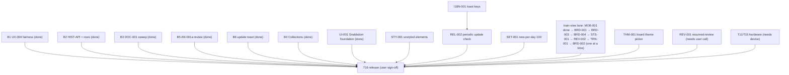

## Wave B/C execution graph (autonomous loop)

Loop rules: a task is **ready** when all deps are Done and none of its
`Owns` paths are touched by another running task. Each round the coordinator
spawns all ready tasks in parallel, then verifies combined
(`npm test`, `npm run typecheck`, `npm run build`), commits if green, updates
this file, and starts the next round. Stop at user-gated items.
`PROJECT_PLAN.md` wording stays coordinator-owned; agents never edit it.
No pushes; commits only.

| ID | Task | Deps | Owns (exclusive) | Status |
|---|---|---|---|---|
| B1 | UX-004 queue tiebreaker: document + lock simultaneous-due order | UX-001 (done) | `packages/scheduler/src/selection.ts`, `packages/scheduler/tests/**` | Done (`a328313`) |
| B2 | HIST-API: read-only `listAttempts` + History per-attempt rows | History view (done) | `apps/web/src/scheduler-service.ts` (append-only method), `apps/web/src/history-view.ts`, `apps/web/src/i18n.ts` (`history.*` only), `apps/web/tests/history*` | Done (`a328313`) |
| B3 | DOC-001 sweep: `screens.ts` header, ADR 001–004 accept/defer note, T13 status note | — | `apps/web/src/screens.ts` (header comment only), `docs/research/adr-sweep.md` (new) | Done (`a328313`; ADR accept/defer still pending user) |
| B5 | AN-001a attempt review (no engine): step through own attempt moves | UX-001 (done) | `apps/web/src/train-view.ts`, `apps/web/src/puzzle-game.ts`, `apps/web/src/training-adapter.ts`, `apps/web/src/i18n.ts` (`review.*` only), `apps/web/tests/review*` | Done (`ce3f011`) |
| B6 | REL-001 remainder: in-app "update available" reload toast | REL-001 policy (done) | `apps/web/src/app.ts` (SW registration only), `apps/web/src/i18n.ts` (`app.update.*` only) | Done (`ce3f011`; strings hardcoded → I18N-001) |
| B4 | T13-followup real Collections screen — **USER DECISION 2026-10-15: per-collection separate progress; static sets with multi-membership; active-collection picker on Train. Overrides ADR-002 proposal (per-program). Schedule rekey to collection scope + schema bump/migration approved in principle; raw history preserved.** | B3, ~~user scope~~ decided | `packages/contracts` (ProgressKey scope), `apps/web/src/scheduler-service.ts`, `apps/web/src/collections-view.ts` (new), `apps/web/src/screens.ts` (collections entry), `apps/web/src/app.ts`, `apps/web/src/train-view.ts` (picker), `apps/web/src/i18n.ts` (`collections.*`), storage/migration | Done (`ec3fa0e`) |
| UI-001 | Snabbdom foundation S0–S7 (spike, theme+primitives+LICENSE, 5 screen migrations, cleanup) | — | `apps/web/src/ui/**`, `theme.css`, all `*-view.ts` (past rounds) | Done (see round log) |
| STY-001 | Style rendered-but-unstyled elements (badge, attempt-table, field.checkbox) | MOB-001 (done — shared CSS now free) | `theme.css`/`app.css` (styling only) | Ready |
| I18N-001 | Localize update toast (`app.update.*` keys) | B6 (done) | `i18n.ts` (`app.update.*`), `app.ts` (toast region) | Done (`1355615`) |
| REL-002 | Periodic SW update check for long-lived tabs | I18N-001 (done — `app.ts` SW region now free) | `app.ts` (SW region only) | Ready |
| SET-001 | Default new-per-day 10 → 100 | — | `settings-preferences.ts`, related tests | Done (`1355615`) |
| MOB-001 | Mobile review layout (board → arrows → details) + ◀ ▶ symbol buttons | — | `train-view.ts` (review-controls region), layout CSS | Done (`1355615`) |
| BRD-001 | Premoves + selection persistence across reply | — | `train-view.ts` (input region), `puzzle-game.ts`, related tests | Ready — train-view lane |
| BRD-003 | Restart-after-complete as new scored attempt | — | `train-view.ts` (completion region), related tests | Ready — train-view lane |
| BRD-004 | Reveal plays out solution on board | — | `train-view.ts` (reveal region), `puzzle-game.ts` (playback helper) | Ready — train-view lane |
| STS-001 | Per-puzzle training status on Train page | — | `train-view.ts` (status region), related tests | Ready — train-view lane |
| REV-002 | Arrow-key review stepping (Left/Right/Up/Down, review-only) | — | `train-view.ts` (review region), related tests | Ready — train-view lane |
| TRN-001 | Train controls polish: `>` Next (hidden when disabled), `↻` restart symbol, analyze placeholder, details-after-completion, live timer | — | `train-view.ts` (controls region), layout CSS, related tests | Ready — train-view lane |
| BRD-002 | Bigger desktop board + expand toggle | MOB-001 (shared layout CSS — serialize) | layout CSS, `train-view.ts` (board region) | Ready after MOB-001 — train-view lane, last |
| THM-001 | Board theme picker (survey Lichess/chessground theming first; square colors only, pieces untouched; localStorage persistence) | BRD-002 (shared board CSS — serialize) | `settings-view.ts` (picker region), board-theme CSS, related tests | Ready after BRD-002 |
| REV-001 | Resumed completions show no review section (keep vs fix) | **user call** | `train-view.ts` (review gating) | **Blocked: needs user call** |
| HW | T11/T15 hardware matrix execution | Matrix written (done) | real device | **Blocked: needs device** |
| RF-001 | React + component library (PROPOSED, see BACKLOG) | architecture decision (accepted ADR) | — | **Parked: loop must skip (UI-001 Snabbdom foundation done instead, 2026-10-16)** |
| T16 | First usable release | B1 B2 B3 B5 B6 B4 HW UI-001 STY-001 I18N-001 REL-002 SET-001 MOB-001 BRD-001 BRD-002 BRD-003 BRD-004 STS-001 THM-001 REV-001 REV-002 TRN-001 | — | **Blocked: user sign-off** |

Round log:
- R1: B1 + B2 + B3 (disjoint paths) — Done 2026-10-15 (`a328313`). 111 tests green (7+35+69), typecheck + build clean. B1: behavior unchanged, tiebreaker locked by comment + 10 fairness tests. B2: `listAttempts` + per-attempt rows. B3: header fix + adr-sweep note (recommends accept 001/004 for local scope, defer 002/003; T13 reword proposed).
- R2 (planned): B5 + B6 (B6 barred from `i18n.ts` so both run parallel). B4 waits on user scope.
- R2: B5 + B6 — Done 2026-10-15 (`ce3f011`). 120 tests green (7+35+78), typecheck + build clean. B5: `ReviewNavigator` + TrainView stepping, review-only, no state mutation. B6: update toast + SKIP_WAITING; I18N-FOLLOWUP (`app.update.available/reload`) open.
- R3: B4 + practice-scope fix — Done 2026-10-15. 136 tests green (7+35+94), typecheck + build + smoke clean. Per-collection separate progress (user decision, overrides ADR-002); 3-part keys with legacy cross-scope read fallback; EXPORT_FORMAT_VERSION 1.0.0→1.1.0 with appended migration; collections in export/import; real Collections screen; active picker on Train. I18N-FOLLOWUP still open.
- UI-001 rounds (plan `~/.opencode/plan/ui-foundation.md`) — Done 2026-10-16. R1 (`e4af88f`): S0 spike + S1 foundation (snabbdom 3.6.4 MIT, theme.css, primitives, AGPL LICENSE). R2 (`be18b93`): S2 History pilot. R3 (`fd682ae`): S3 Collections + S4 Settings parallel (caught + fixed a dropped `data-restore` smoke hook). R4 (`a010f53`): S5 Puzzles with hook audit. R5 (`7a24b47`): S6 Train, board outside patched tree, 60-redraw storm proof. R6 (`286bbad`): S7 shared patch helper, primitive options, zero dead selectors. Final: 194 tests (7+35+152), build + smoke 38/38 clean.
- Lane rule (added 2026-10-16): `train-view.ts` is touched by MOB-001, BRD-001, BRD-003, BRD-004, STS-001, BRD-002 — run that lane one task at a time (suggested order in diagram); `app.ts` SW region shared by I18N-001 → REL-002 (serialize). STY-001 and SET-001 are free any time.
- UX batch R1 — Done 2026-10-16 (`1355615`): SET-001 + I18N-001 + MOB-001 parallel (disjoint paths). 197 tests (7+35+155), typecheck + build + smoke 38/38 clean. Train lane now free for BRD-001; STY-001 unblocked (shared CSS free); REL-002 unblocked (`app.ts` SW region free).
