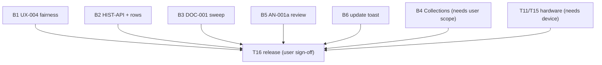

## Wave B/C execution graph (autonomous loop)

Loop rules: a task is **ready** when all deps are Done and none of its
`Owns` paths are touched by another running task. Each round the coordinator
spawns all ready tasks in parallel, then verifies combined
(`npm test`, `npm run typecheck`, `npm run build`), commits if green, updates
this file, and starts the next round. Stop at user-gated items.
`PROJECT_PLAN.md` wording stays coordinator-owned; agents never edit it.
No pushes; commits only.

| ID | Task | Deps | Owns (exclusive) | Status |
|---|---|---|---|---|
| B1 | UX-004 queue tiebreaker: document + lock simultaneous-due order | UX-001 (done) | `packages/scheduler/src/selection.ts`, `packages/scheduler/tests/**` | Ready |
| B2 | HIST-API: read-only `listAttempts` + History per-attempt rows | History view (done) | `apps/web/src/scheduler-service.ts` (append-only method), `apps/web/src/history-view.ts`, `apps/web/src/i18n.ts` (`history.*` only), `apps/web/tests/history*` | Ready |
| B3 | DOC-001 sweep: `screens.ts` header, ADR 001–004 accept/defer note, T13 status note | — | `apps/web/src/screens.ts` (header comment only), `docs/research/adr-sweep.md` (new) | Ready |
| B5 | AN-001a attempt review (no engine): step through own attempt moves | UX-001 (done) | `apps/web/src/train-view.ts`, `apps/web/src/puzzle-game.ts`, `apps/web/src/training-adapter.ts`, `apps/web/src/i18n.ts` (`review.*` only), `apps/web/tests/review*` | Ready after R1 (shares `train-view.ts` history with UX-001 commit, now landed — actually free) |
| B6 | REL-001 remainder: in-app "update available" reload toast | REL-001 policy (done) | `apps/web/src/app.ts` (SW registration only), `apps/web/src/i18n.ts` (`app.update.*` only) | Ready after R1 |
| B4 | T13-followup real Collections screen | B3, **user scope decision (Q09)** | `apps/web/src/screens.ts` (collections entry), `apps/web/src/collections-view.ts` (new), `apps/web/src/app.ts`, `apps/web/src/i18n.ts` (`collections.*`) | **Blocked: needs user scope** |
| HW | T11/T15 hardware matrix execution | Matrix written (done) | real device | **Blocked: needs device** |
| T16 | First usable release | B1 B2 B3 B5 B6 B4 HW | — | **Blocked: user sign-off** |

Round log:
- R1: B1 + B2 + B3 (disjoint paths) — Done 2026-10-15 (`a328313`). 111 tests green (7+35+69), typecheck + build clean. B1: behavior unchanged, tiebreaker locked by comment + 10 fairness tests. B2: `listAttempts` + per-attempt rows. B3: header fix + adr-sweep note (recommends accept 001/004 for local scope, defer 002/003; T13 reword proposed).
- R2 (planned): B5 + B6 (B6 barred from `i18n.ts` so both run parallel). B4 waits on user scope.
