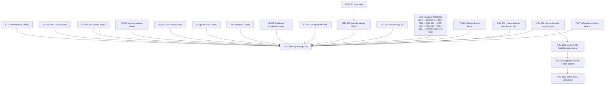

## Wave B/C execution graph (autonomous loop)

Loop rules: a task is **ready** when all deps are Done and none of its
`Owns` paths are touched by another running task. Each round the coordinator
spawns all ready tasks in parallel, then verifies combined
(`npm test`, `npm run typecheck`, `npm run build`), commits if green, updates
this file, and starts the next round. Stop at user-gated items.
`PROJECT_PLAN.md` wording stays coordinator-owned; agents never edit it.
No pushes; commits only.

| ID | Task | Deps | Owns (exclusive) | Status |
|---|---|---|---|---|
| B1 | UX-004 queue tiebreaker: document + lock simultaneous-due order | UX-001 (done) | `packages/scheduler/src/selection.ts`, `packages/scheduler/tests/**` | Done (`a328313`) |
| B2 | HIST-API: read-only `listAttempts` + History per-attempt rows | History view (done) | `apps/web/src/scheduler-service.ts` (append-only method), `apps/web/src/history-view.ts`, `apps/web/src/i18n.ts` (`history.*` only), `apps/web/tests/history*` | Done (`a328313`) |
| B3 | DOC-001 sweep: `screens.ts` header, ADR 001–004 accept/defer note, T13 status note | — | `apps/web/src/screens.ts` (header comment only), `docs/research/adr-sweep.md` (new) | Done (`a328313`; ADR accept/defer still pending user) |
| B5 | AN-001a attempt review (no engine): step through own attempt moves | UX-001 (done) | `apps/web/src/train-view.ts`, `apps/web/src/puzzle-game.ts`, `apps/web/src/training-adapter.ts`, `apps/web/src/i18n.ts` (`review.*` only), `apps/web/tests/review*` | Done (`ce3f011`) |
| B6 | REL-001 remainder: in-app "update available" reload toast | REL-001 policy (done) | `apps/web/src/app.ts` (SW registration only), `apps/web/src/i18n.ts` (`app.update.*` only) | Done (`ce3f011`; strings hardcoded → I18N-001) |
| B4 | T13-followup real Collections screen — **USER DECISION 2026-10-15: per-collection separate progress; static sets with multi-membership; active-collection picker on Train. Overrides ADR-002 proposal (per-program). Schedule rekey to collection scope + schema bump/migration approved in principle; raw history preserved.** | B3, ~~user scope~~ decided | `packages/contracts` (ProgressKey scope), `apps/web/src/scheduler-service.ts`, `apps/web/src/collections-view.ts` (new), `apps/web/src/screens.ts` (collections entry), `apps/web/src/app.ts`, `apps/web/src/train-view.ts` (picker), `apps/web/src/i18n.ts` (`collections.*`), storage/migration | Done (`ec3fa0e`) |
| UX-005 | Remove practice-ahead button/selector path; retain normal due/new eligibility and next-due status | UX-001 (done; user rejects practice-ahead design) | `apps/web/src/scheduler-service.ts` selection fallback only, `apps/web/src/train-view.ts` practice controls/status only, related tests | Done (current round) |
| UI-001 | Snabbdom foundation S0–S7 (spike, theme+primitives+LICENSE, 5 screen migrations, cleanup) | — | `apps/web/src/ui/**`, `theme.css`, all `*-view.ts` (past rounds) | Done (see round log) |
| STY-001 | Style rendered-but-unstyled elements (badge, attempt-table, field.checkbox) | MOB-001 (done — shared CSS now free) | `theme.css`/`app.css` (styling only) | Done (`f2e2d2e`) |
| I18N-001 | Localize update toast (`app.update.*` keys) | B6 (done) | `i18n.ts` (`app.update.*`), `app.ts` (toast region) | Done (`1355615`) |
| REL-002 | Periodic SW update check for long-lived tabs | I18N-001 (done — `app.ts` SW region now free) | `app.ts` (SW region only) | Done (`f2e2d2e`) |
| SET-001 | Default new-per-day 10 → 100 | — | `settings-preferences.ts`, related tests | Done (`1355615`) |
| MOB-001 | Mobile review layout (board → arrows → details) + ◀ ▶ symbol buttons | — | `train-view.ts` (review-controls region), layout CSS | Done (`1355615`) |
| BRD-001 | Premoves + selection persistence across reply | — | `train-view.ts` (input region), `puzzle-game.ts`, related tests | Done (`f2e2d2e`) |
| BRD-003 | Restart-after-complete as new scored attempt | BRD-001 | `train-view.ts` (completion region), related tests | Done (`fb0995d`) |
| BRD-004 | Reveal plays out solution on board | BRD-003 | `train-view.ts` (reveal region), `puzzle-game.ts` (playback helper) | Done (`8168c73`) |
| STS-001 | Per-puzzle training status on Train page | BRD-004 | `train-view.ts` (status region), related tests | Done (current loop) |
| REV-002 | Arrow-key review stepping (Left/Right/Up/Down, review-only) | STS-001 | `train-view.ts` (review region), related tests | Done (current loop) |
| TRN-001 | Train controls polish: symbolic Next, no visible Skip/First/Last, conditional Analyze, completion-only details, live timer | REV-002 | `train-view.ts` (controls region), layout CSS, related tests | Done (current loop; refined) |
| BRD-002 | Bigger desktop board; no toggle/card/title; 900px centered container; actions beneath board; timer always visible | MOB-001 | layout CSS, `train-view.ts` (board region) | Done (refined current loop) |
| THM-001 | Board theme picker (survey Lichess/chessground theming first; square colors only, pieces untouched; localStorage persistence) | BRD-002 (done) | `settings-view.ts` (picker region), board-theme CSS, related tests | Done (current loop) |
| PZL-001 | Lichess-inspired puzzle layout: controls/feedback, board, details in three desktop columns; board-first stack mobile | UI-001, BRD-002 (done) | `train-view.ts` shell/view layout, `app.css`, train view tests, smoke | Done (refined current loop) |
| PZL-002a | Source-game PGN feasibility, source/provenance, and pack selection policy | PZL-001 | `docs/research/source-game-pgn.md` (new), read-only tooling audit | Done (current round; legal clearance remains a gate for bundling) |
| PZL-002b | Optional PGN content model + reproducible pack retrieval/validation + export/import/migration | PZL-002a; approve schema/version policy before implementation | `tools/puzzles/**`, contracts/content validation/storage/data-port as approved; single owner | Blocked on PZL-002a review + schema plan |
| PZL-002c | Display bundled game prelude in moves panel; gracefully omit when absent/offline | PZL-002b | `apps/web/src/train-view.ts`, `apps/web/src/puzzle-game.ts` only if needed, related tests/smoke | Blocked on PZL-002b |
| REV-001 | Resumed completions show no review section (keep vs fix) | **user call** | `train-view.ts` (review gating) | **Blocked: needs user call** |
| HW | T11/T15 hardware matrix execution | Matrix written (done) | real device | **Blocked: needs device** |
| RF-001 | React + component library (PROPOSED, see BACKLOG) | architecture decision (accepted ADR) | — | **Parked: loop must skip (UI-001 Snabbdom foundation done instead, 2026-10-16)** |
| T16 | First usable release | B1 B2 B3 B5 B6 B4 HW UI-001 STY-001 I18N-001 REL-002 SET-001 MOB-001 BRD-001 BRD-002 BRD-003 BRD-004 STS-001 THM-001 PZL-001 UX-005 REV-001 REV-002 TRN-001 | — | **Blocked: user sign-off** |

Round log:
- R1: B1 + B2 + B3 (disjoint paths) — Done 2026-10-15 (`a328313`). 111 tests green (7+35+69), typecheck + build clean. B1: behavior unchanged, tiebreaker locked by comment + 10 fairness tests. B2: `listAttempts` + per-attempt rows. B3: header fix + adr-sweep note (recommends accept 001/004 for local scope, defer 002/003; T13 reword proposed).
- R2 (planned): B5 + B6 (B6 barred from `i18n.ts` so both run parallel). B4 waits on user scope.
- R2: B5 + B6 — Done 2026-10-15 (`ce3f011`). 120 tests green (7+35+78), typecheck + build clean. B5: `ReviewNavigator` + TrainView stepping, review-only, no state mutation. B6: update toast + SKIP_WAITING; I18N-FOLLOWUP (`app.update.available/reload`) open.
- R3: B4 + practice-scope fix — Done 2026-10-15. 136 tests green (7+35+94), typecheck + build + smoke clean. Per-collection separate progress (user decision, overrides ADR-002); 3-part keys with legacy cross-scope read fallback; EXPORT_FORMAT_VERSION 1.0.0→1.1.0 with appended migration; collections in export/import; real Collections screen; active picker on Train. I18N-FOLLOWUP still open.
- UI-001 rounds (plan `~/.opencode/plan/ui-foundation.md`) — Done 2026-10-16. R1 (`e4af88f`): S0 spike + S1 foundation (snabbdom 3.6.4 MIT, theme.css, primitives, AGPL LICENSE). R2 (`be18b93`): S2 History pilot. R3 (`fd682ae`): S3 Collections + S4 Settings parallel (caught + fixed a dropped `data-restore` smoke hook). R4 (`a010f53`): S5 Puzzles with hook audit. R5 (`7a24b47`): S6 Train, board outside patched tree, 60-redraw storm proof. R6 (`286bbad`): S7 shared patch helper, primitive options, zero dead selectors. Final: 194 tests (7+35+152), build + smoke 38/38 clean.
- Lane rule (added 2026-10-16): `train-view.ts` is touched by MOB-001, BRD-001, BRD-003, BRD-004, STS-001, BRD-002 — run that lane one task at a time (suggested order in diagram); `app.ts` SW region shared by I18N-001 → REL-002 (serialize). STY-001 and SET-001 are free any time.
- UX batch R1 — Done 2026-10-16 (`1355615`): SET-001 + I18N-001 + MOB-001 parallel (disjoint paths). 197 tests (7+35+155), typecheck + build + smoke 38/38 clean.
- UX batch R2 — Done 2026-10-16 (`f2e2d2e`): BRD-001 + STY-001 + REL-002 parallel. 204 tests (7+35+162), build + smoke 38/38 clean. Premove queue + selection re-assert; three CSS fixes; hourly + visible update checks.
- UX lane R3 — Done 2026-10-16 (`fb0995d`): BRD-003 restart creates a distinct scored attempt; prior history immutable. 207 tests, build + smoke clean.
- UX lane R4 — Done 2026-10-16 (`8168c73`): BRD-004 paced reveal playback; on-line remainder/off-line full reset, cancellation and stale-timer tests. 217 tests, build + smoke clean.
- UX lane R5 — STS-001 done (`d228b8c`): pure per-puzzle schedule/history projection, 7+35+178 tests, build + smoke 38/38 clean.
- UX lane R6 — REV-002 done 2026-10-16: review-only arrow keys reuse button stepping; listener lifecycle covered. 7+35+179 tests, build + smoke 38/38 clean. Next train-lane tasks: TRN-001, then BRD-002.
- UX lane R7 — TRN-001 verified 2026-10-16: next/restart/analyze controls, hide rating/themes until completion, live timer. 7+35+180 tests, build + smoke 38/38 clean. Next: BRD-002.
- UX lane R8 — BRD-002 done 2026-10-16: larger desktop board + session toggle, mobile preserved, no-remount identity test. 7+35+181 tests, build + smoke 38/38 clean. Next eligible: THM-001 board theme picker.
- UX lane R9 — THM-001 done 2026-10-16: five clean-room square palettes; localStorage persistence applied before router to prevent flash; piece art untouched; research note added. 7+35+186 tests, typecheck + build + smoke 38/38 clean.
- UX lane R10 — BRD-002 refinement done 2026-10-16: expanded board now default, collapse toggle removed; actions/review controls under board, puzzle details after. 7+35+187 tests, typecheck + build + smoke 38/38 clean; S6 host-outside-tree invariant retained.
- UX lane R11 — BRD-002 visual refinement done 2026-10-16: removed board card/title; timer pinned in viewport safe area. 7+35+188 tests, build + smoke 38/38 clean.
- UX lane R12 — control/layout refinement done 2026-10-16: remove visible Skip and First/Last review buttons while preserving keyboard shortcuts; Analyze only on failure/completion; board and actions share centered 900px width. 7+35+188 tests, build + smoke 38/38 clean.
- UX lane R13 — PZL-001 done 2026-10-16: Lichess-inspired board-left/panel-right desktop, board-first stacked mobile; prominent feedback/timer; smoke checks both geometries. 7+35+188 tests, typecheck + build + smoke 42/42 clean; board remains outside patched tree.
- UX lane R14 — PZL-001 refined per user: desktop three columns (controls/feedback, board, details); mobile board → controls → details. Multiple patch roots keep board host static; smoke checks desktop/mobile. 7+35+188 tests, typecheck + build + smoke 42/42 clean.
- UX lane R15 — PZL-001 panel refinement: one border around right panel; move list, compact feedback plus Show solution/Hint, arrows anchored at bottom; left two sections (Training Status, Puzzle with collection/queue); no standalone Solution panel. Hint highlights next source square and records assistance only. 7+35+189 tests, typecheck + build + smoke 44/44 clean.
- UX batch R17 — UX-005 + PZL-002a parallel, done 2026-10-16. UX-005 removed practice-ahead and preserved normal due/new eligibility + nextDueAt. PZL-002a found the CSV links source games but does not contain PGN; Lila server supplies a SAN prefix from its game repository; blanket source-game PGN redistribution rights are not established. Report: `docs/research/source-game-pgn.md`. Combined: 7+35+189 tests, typecheck + build + smoke 44/44 clean. PZL-002b remains blocked on context scope, provenance/legal clearance, and schema/export/migration design.
